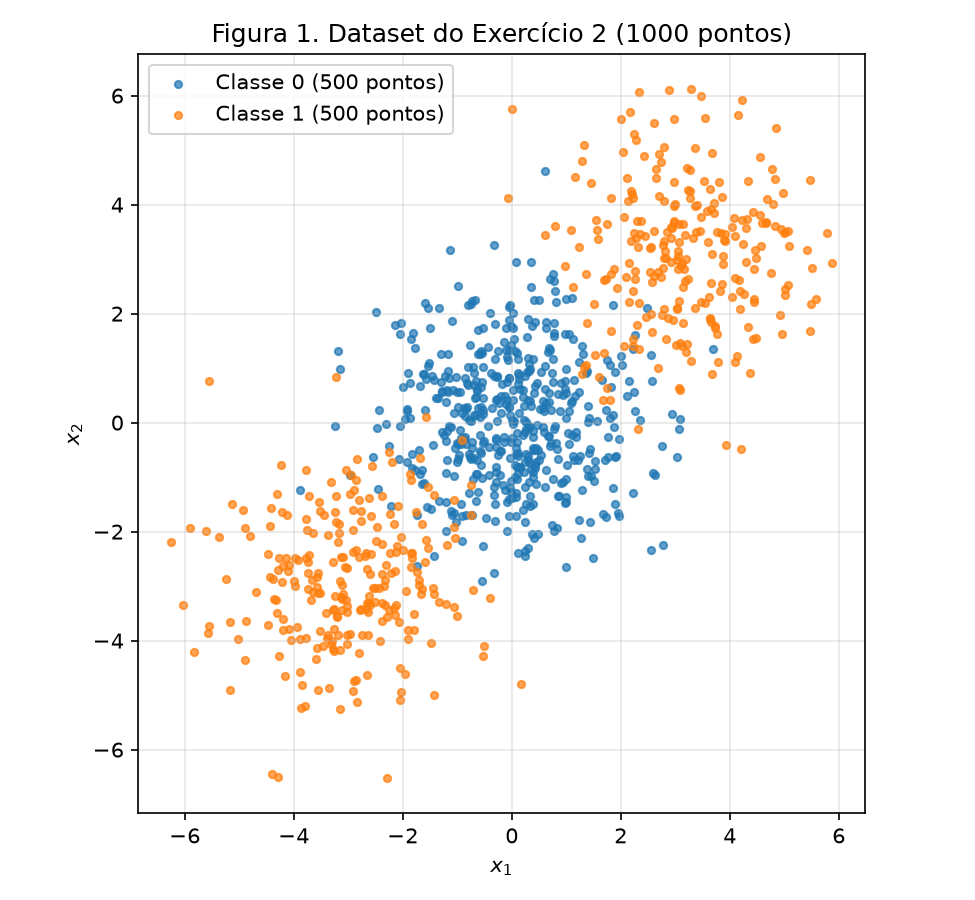
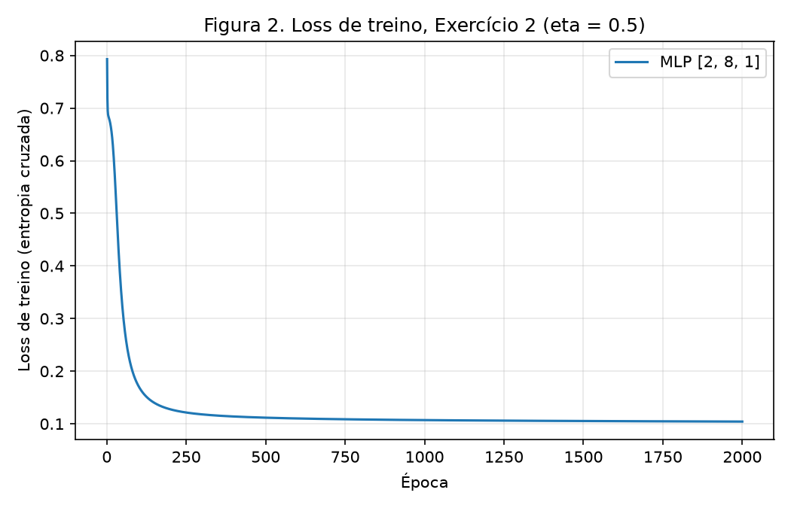
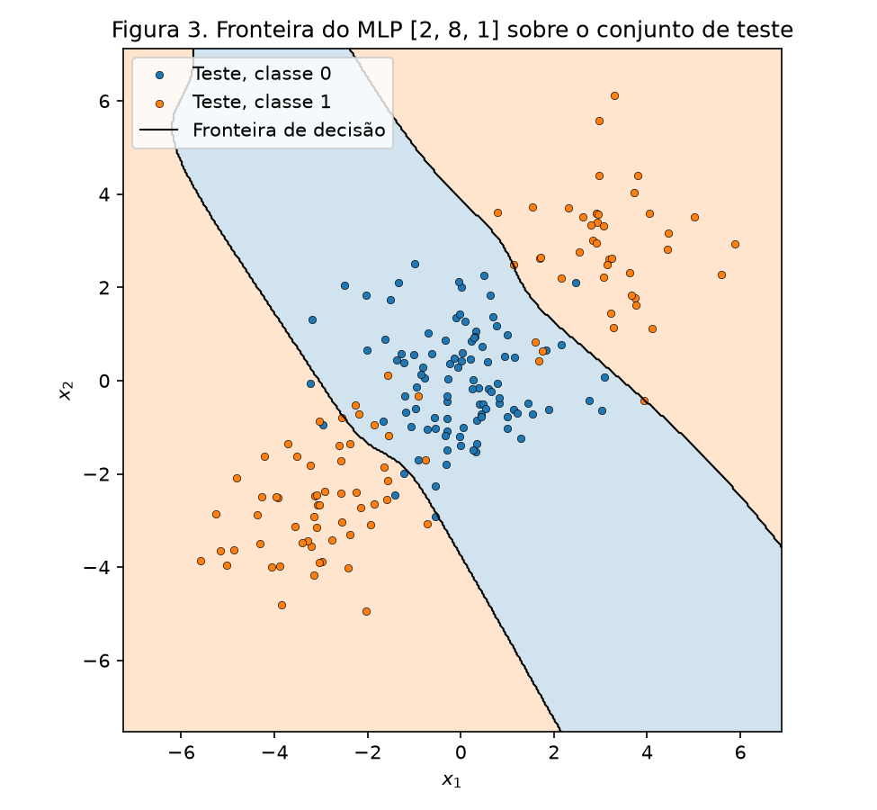
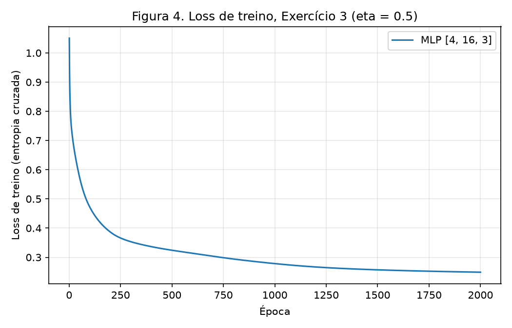
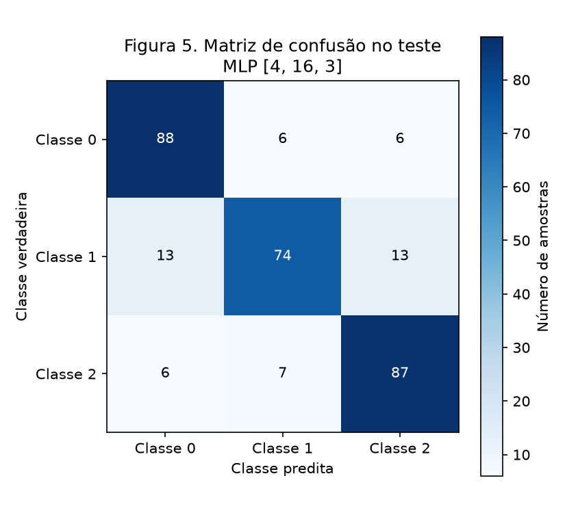
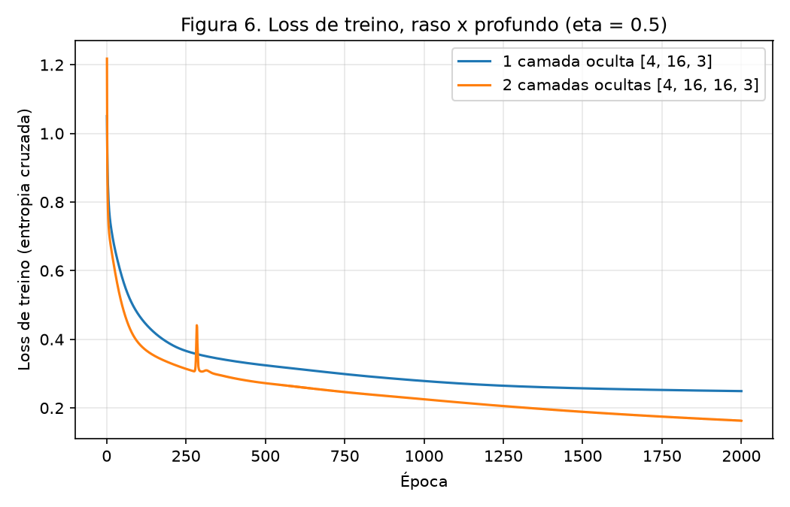

# 3. MLP

!!! abstract "Enunciado"

    [Exercises → MLP](https://insper.github.io/ann-dl/){:target='_blank'}

## Exercise 1

Rede 2-2-1 com tanh nas duas camadas e $L = (y-\hat y)^2$, numa única amostra. Notação do
enunciado: $\mathbf{W}^{(1)}$ (linha $i$ = pesos do neurônio oculto $i$), $\mathbf{b}^{(1)}$,
$\mathbf{W}^{(2)}$, $b^{(2)}$. Valores dados:

$$
\mathbf{x} = \begin{bmatrix} 0.5 \\ -0.2 \end{bmatrix},\quad y = 1.0,\quad
\mathbf{W}^{(1)} = \begin{bmatrix} 0.3 & -0.1 \\ 0.2 & 0.4 \end{bmatrix},\quad
\mathbf{b}^{(1)} = \begin{bmatrix} 0.1 \\ -0.2 \end{bmatrix},\quad
\mathbf{W}^{(2)} = \begin{bmatrix} 0.5 & -0.3 \end{bmatrix},\quad
b^{(2)} = 0.2,\quad \eta = 0.3
$$

As contas abaixo foram feitas à mão, com 4 casas decimais; os valores intermediários
arredondados não acumulam erro visível na quarta casa.

### A: Forward pass

**Pré-ativação da camada oculta**, $\mathbf{z}^{(1)} = \mathbf{W}^{(1)}\mathbf{x} + \mathbf{b}^{(1)}$:

$$
\begin{aligned}
z^{(1)}_1 &= 0.3(0.5) + (-0.1)(-0.2) + 0.1 = 0.15 + 0.02 + 0.1 = 0.2700 \\
z^{(1)}_2 &= 0.2(0.5) + 0.4(-0.2) - 0.2 = 0.10 - 0.08 - 0.2 = -0.1800
\end{aligned}
$$

**Ativação oculta**, $\mathbf{h}^{(1)} = \tanh(\mathbf{z}^{(1)})$:

$$
h^{(1)}_1 = \tanh(0.27) = 0.2636, \qquad h^{(1)}_2 = \tanh(-0.18) = -0.1781
$$

**Pré-ativação da saída**, $u^{(2)} = \mathbf{W}^{(2)}\mathbf{h}^{(1)} + b^{(2)}$:

$$
u^{(2)} = 0.5(0.2636) + (-0.3)(-0.1781) + 0.2 = 0.1318 + 0.0534 + 0.2 = 0.3852
$$

**Saída e loss**:

$$
\hat y = \tanh(0.3852) = 0.3672, \qquad L = (1.0 - 0.3672)^2 = (0.6328)^2 = 0.4004
$$

### B: Backward pass

Usando $\frac{d}{du}\tanh(u) = 1 - \tanh^2(u)$, cada derivada local reaproveita a saída já
calculada no forward.

**Saída:**

$$
\begin{aligned}
\frac{\partial L}{\partial \hat y} &= -2(y - \hat y) = -2(0.6328) = -1.2655 \\
\frac{\partial L}{\partial u^{(2)}} &= \frac{\partial L}{\partial \hat y}\,(1 - \hat y^2)
  = -1.2655 \times (1 - 0.3672^2) = -1.2655 \times 0.8651 = -1.0948
\end{aligned}
$$

**Gradientes da camada de saída** ($u^{(2)} = \sum_i W^{(2)}_i h^{(1)}_i + b^{(2)}$):

$$
\begin{aligned}
\frac{\partial L}{\partial \mathbf{W}^{(2)}} &= \frac{\partial L}{\partial u^{(2)}}\,\mathbf{h}^{(1)\top}
  = -1.0948 \times [0.2636,\ -0.1781] = [-0.2886,\ 0.1950] \\
\frac{\partial L}{\partial b^{(2)}} &= \frac{\partial L}{\partial u^{(2)}} = -1.0948
\end{aligned}
$$

**Propagação para a camada oculta:**

$$
\begin{aligned}
\frac{\partial L}{\partial \mathbf{h}^{(1)}} &= \frac{\partial L}{\partial u^{(2)}}\,\mathbf{W}^{(2)\top}
  = -1.0948 \times [0.5,\ -0.3] = [-0.5474,\ 0.3284] \\
\frac{\partial L}{\partial \mathbf{z}^{(1)}} &= \frac{\partial L}{\partial \mathbf{h}^{(1)}} \odot (1 - \mathbf{h}^{(1)2})
  = [-0.5474 \times 0.9305,\ \ 0.3284 \times 0.9683] = [-0.5094,\ 0.3180]
\end{aligned}
$$

**Gradientes da camada oculta** ($z^{(1)}_i = \sum_j W^{(1)}_{ij} x_j + b^{(1)}_i$, logo
$\partial L / \partial W^{(1)}_{ij} = \frac{\partial L}{\partial z^{(1)}_i} x_j$):

$$
\begin{aligned}
\frac{\partial L}{\partial \mathbf{W}^{(1)}} &= \frac{\partial L}{\partial \mathbf{z}^{(1)}}\,\mathbf{x}^\top
  = \begin{bmatrix} -0.5094 \\ 0.3180 \end{bmatrix} \begin{bmatrix} 0.5 & -0.2 \end{bmatrix}
  = \begin{bmatrix} -0.2547 & 0.1019 \\ 0.1590 & -0.0636 \end{bmatrix} \\
\frac{\partial L}{\partial \mathbf{b}^{(1)}} &= \frac{\partial L}{\partial \mathbf{z}^{(1)}} = [-0.5094,\ 0.3180]
\end{aligned}
$$

### C: Parameter update

Gradiente descendente, $\theta \leftarrow \theta - \eta\,\partial L/\partial\theta$ com
$\eta = 0.3$, em todos os parâmetros da rede:

| Parâmetro | Antes | Gradiente | Depois |
|-----------|------:|----------:|-------:|
| $W^{(1)}_{11}$ | 0.3000 | −0.2547 | **0.3764** |
| $W^{(1)}_{12}$ | −0.1000 | 0.1019 | **−0.1306** |
| $W^{(1)}_{21}$ | 0.2000 | 0.1590 | **0.1523** |
| $W^{(1)}_{22}$ | 0.4000 | −0.0636 | **0.4191** |
| $b^{(1)}_1$ | 0.1000 | −0.5094 | **0.2528** |
| $b^{(1)}_2$ | −0.2000 | 0.3180 | **−0.2954** |
| $W^{(2)}_1$ | 0.5000 | −0.2886 | **0.5866** |
| $W^{(2)}_2$ | −0.3000 | 0.1950 | **−0.3585** |
| $b^{(2)}$ | 0.2000 | −1.0948 | **0.5284** |

**Segundo forward com os parâmetros novos:**
$\mathbf{z}^{(1)} = [0.4671,\ -0.3031]$, $\mathbf{h}^{(1)} = [0.4359,\ -0.2941]$,
$u^{(2)} = 0.8896$, $\hat y = 0.7112$ e $L = (1 - 0.7112)^2 = 0.0834$.

A loss **cai**, de 0.4004 para 0.0834. É o esperado: cada parâmetro andou na direção oposta
ao próprio gradiente, que é a direção de maior descida local de $L$, e o passo $\eta = 0.3$
é pequeno o bastante para que a aproximação linear de $L$ em torno do ponto atual continue
valendo. Todas as mudanças empurram $\hat y$ para cima, em direção a $y = 1$: o viés de saída
sobe (0.2 → 0.5284), o peso de saída positivo cresce e o negativo fica mais negativo
(lembrando que $h^{(1)}_2 < 0$, então $W^{(2)}_2 h^{(1)}_2$ aumenta), e a camada oculta
aumenta $|h^{(1)}_1|$ e $|h^{(1)}_2|$, alimentando a saída com sinais maiores.

## Exercise 2

### Abordagem

Um único MLP genérico, escrito uma vez e reaproveitado **sem nenhuma alteração** nos
Exercícios 2, 3 e 4. O tamanho das camadas (`sizes`), a ativação de saída (`output`), $\eta$
e o número de épocas são argumentos; `forward`, `backward` e `update` são o mesmo código nos
três exercícios. As camadas ocultas usam tanh. O treino é gradiente descendente em lote
completo (todos os pontos de treino a cada época), o que deixa as curvas de loss
determinísticas dada a inicialização. A mesma instância `rng = np.random.default_rng(42)`
sorteia a inicialização de todos os modelos dos Exercícios 2, 3 e 4A; a única exceção é a
comparação com várias sementes do item 4B (ver lá).

O backward foi conferido contra diferenças finitas centradas numa rede `[3, 4, 4, k]` com
saída sigmoid e softmax: o maior erro relativo entre o gradiente analítico e o numérico foi
$5.04 \times 10^{-9}$.

### Código

O script vive em [`code/mlp.py`](https://github.com/lucacm/ann-dl-2026-2/blob/main/docs/exercises/mlp/code/mlp.py)
e é incluído aqui pelo próprio arquivo, por trecho.

``` { .python .copy .select linenums='1' title="docs/exercises/mlp/code/mlp.py" }
--8<-- "docs/exercises/mlp/code/mlp.py:setup"

--8<-- "docs/exercises/mlp/code/mlp.py:mlp"
```

1.  Semente única, criada uma vez e reaproveitada em todo o script: sem ela os números da
    tabela de resultados mudam a cada execução.

### A: Generate the data

``` { .python .copy .select linenums='1' title="docs/exercises/mlp/code/mlp.py" }
--8<-- "docs/exercises/mlp/code/mlp.py:ex2_data"
```

1.  Cluster 0 (centro na origem) vira a classe 0; os clusters 1 e 2, nos cantos opostos
    $(3,3)$ e $(-3,-3)$, viram juntos a classe 1. Cada classe tem 500 pontos.

O split estratificado deixa 800 pontos de treino e 200 de teste, 100 de cada classe.


/// caption
**Figura 1.** Os 1000 pontos do Exercício 2, coloridos por classe.
///

### B: Establish the baseline

``` { .python .copy .select linenums='1' title="docs/exercises/mlp/code/mlp.py" }
--8<-- "docs/exercises/mlp/code/mlp.py:ex2_baseline"
```

A regressão logística atinge **47.50%** de acurácia no teste (52.75% no treino), abaixo de
um classificador que chuta sempre a mesma classe (50%). Os coeficientes aprendidos são
praticamente nulos, $\mathbf{w} \approx [0.030,\ 0.001]$ e $b \approx -0.003$: o modelo
desistiu de separar e prevê probabilidade próxima de 0.5 em todo o plano.

### C: Implement the MLP

``` { .python .copy .select linenums='1' title="docs/exercises/mlp/code/mlp.py" }
--8<-- "docs/exercises/mlp/code/mlp.py:ex2_mlp"
```

Saída com 1 unidade sigmoid e loss BCE, que juntas dão
$\partial L / \partial u = (\hat y - y)/N$ na pré-ativação da saída (o mesmo resultado da
softmax do Exercício 3, derivado no item 3B).

- **Arquitetura:** `[2, 8, 1]`, 2 entradas, 8 neurônios tanh, 1 saída sigmoid (33 parâmetros).
- **Treino:** $\eta = 0.5$, 2000 épocas, lote completo, inicialização de Xavier.
- **Loss de treino:** de 0.7930 na primeira época para 0.1043 na última.
- **Acurácia de teste: 91.50%** (96.75% no treino).


/// caption
**Figura 2.** Loss de treino (BCE) × época do MLP `[2, 8, 1]`.
///


/// caption
**Figura 3.** Regiões de decisão do MLP numa grade 400 × 400, com os pontos de teste por cima.
///

### D: Analysis

**Por que o linear fica abaixo de 50% e o MLP passa de 90%.** As duas classes têm a mesma
média: a classe 0 está centrada em $(0,0)$ e a classe 1 é a união de dois blobs em $(3,3)$ e
$(-3,-3)$, cuja média também é $(0,0)$. Qualquer reta divide o plano em dois semiplanos; se
ela cortar a diagonal entre os blobs, deixa um blob da classe 1 de cada lado e cerca de metade
da classe 0 também de cada lado, e se ficar de fora, põe quase tudo do mesmo lado. Em qualquer
caso o melhor que uma fronteira linear consegue aqui fica perto de 50%, e foi exatamente isso
que a regressão logística encontrou ao zerar os pesos. O valor de 47.50%, um pouco abaixo de
50%, é só flutuação amostral de um classificador sem sinal num teste de 200 pontos; não há
nada que o modelo linear tenha aprendido de errado. O MLP, por outro lado, não precisa de uma
única reta: cada neurônio oculto é uma reta, e a camada de saída combina várias delas.

**A região da classe 1 na Figura 3.** A classe 0 ocupa uma faixa diagonal que passa pela
origem, perpendicular à direção $(1,1)$ que liga os dois blobs, e a classe 1 ocupa as **duas
regiões dos lados opostos** dessa faixa, uma no canto superior direito e outra no inferior
esquerdo. A região da classe 1 é, portanto, **desconexa** (duas componentes separadas pela
faixa da classe 0). Uma reta só produz um semiplano, que é conexo e convexo; para obter duas
regiões opostas de mesma classe com algo no meio é preciso pelo menos duas fronteiras
(aproximadamente paralelas, uma de cada lado da faixa), o que é justamente o que a camada
oculta fornece e a saída combina num "fora da faixa". Os erros que restam (91.50%) estão nas
bordas da faixa, onde os blobs com $\sigma = 1.2$ se misturam com o cluster central.

## Exercise 3

### A: Generate the data

``` { .python .copy .select linenums='1' title="docs/exercises/mlp/code/mlp.py" }
--8<-- "docs/exercises/mlp/code/mlp.py:ex3_data"
```

1.  Rótulos em one-hot para a entropia cruzada categórica: a linha $i$ de `Y3_tr` tem 1 na
    coluna da classe de $i$ e 0 nas outras.

São 1500 pontos em 4 dimensões, 3 classes com 2 clusters cada (6 clusters no total). O split
estratificado deixa 1200 pontos de treino e 300 de teste, 100 de cada classe.

### B: Adapt the network

A camada de saída passa a ter 3 unidades com softmax e a loss passa a ser a entropia cruzada
categórica:

$$
\hat y_k = \frac{e^{u_k}}{\sum_j e^{u_j}}, \qquad L = -\sum_k y_k \log \hat y_k
$$

**Derivação de $\partial L / \partial u$.** A derivada da softmax é
$\partial \hat y_k / \partial u_j = \hat y_k(\delta_{kj} - \hat y_j)$ (com $\delta_{kj} = 1$ se
$k = j$ e 0 caso contrário). Pela regra da cadeia,

$$
\frac{\partial L}{\partial u_j}
= \sum_k \frac{\partial L}{\partial \hat y_k}\frac{\partial \hat y_k}{\partial u_j}
= \sum_k \left(-\frac{y_k}{\hat y_k}\right)\hat y_k(\delta_{kj} - \hat y_j)
= -y_j + \hat y_j \sum_k y_k
= \hat y_j - y_j,
$$

usando $\sum_k y_k = 1$ (one-hot). Na média sobre o lote, $\partial L/\partial \mathbf{u} =
(\hat{\mathbf{y}} - \mathbf{y})/N$. É o mesmo formato da sigmoid + BCE do Exercício 2, onde
$\partial L/\partial \hat y = (\hat y - y)/[\hat y(1-\hat y)]$ e
$\partial \hat y/\partial u = \hat y(1-\hat y)$ se cancelam e sobra $\hat y - y$.

**Reuso literal do código do Exercício 2.** Por causa dessa igualdade, `backward` começa de
`delta = (y_hat - Y) / N` nos dois casos e não precisa saber qual saída está em uso. Nada
dentro de `forward`, `backward`, `update` ou `train` foi alterado para o Exercício 3: são as
mesmas funções do trecho `mlp` incluído no Exercício 2, e o que muda são só argumentos,
`sizes=[4, 16, 3]` (3 saídas), `output="softmax"` e os rótulos `Y` em one-hot. A escolha entre
sigmoid e softmax é um dicionário de funções (`OUTPUTS`), e a `loss` decide entre BCE e
entropia cruzada categórica pelo número de colunas de `Y`.

### C: Train and evaluate

``` { .python .copy .select linenums='1' title="docs/exercises/mlp/code/mlp.py" }
--8<-- "docs/exercises/mlp/code/mlp.py:ex3_mlp"
```

- **Arquitetura:** `[4, 16, 3]`, 4 entradas, 16 neurônios tanh, 3 saídas softmax (131 parâmetros).
- **Treino:** $\eta = 0.5$, 2000 épocas, lote completo, inicialização de Xavier.
- **Loss de treino:** de 1.0504 na primeira época para 0.2490 na última.
- **Acurácia de teste: 83.00%** (90.50% no treino).


/// caption
**Figura 4.** Loss de treino (entropia cruzada categórica) × época do MLP `[4, 16, 3]`.
///


/// caption
**Figura 5.** Matriz de confusão no conjunto de teste (linhas: classe verdadeira; colunas:
classe predita).
///

### D: Analysis

**Par mais confundido.** Somando os dois sentidos de erro da Figura 5:

| Par | Erros (verdadeira → predita) | Total |
|-----|------------------------------|------:|
| **1 ↔ 2** | 13 (1→2) + 7 (2→1) | **20** |
| 0 ↔ 1 | 13 (1→0) + 6 (0→1) | 19 |
| 0 ↔ 2 | 6 (0→2) + 6 (2→0) | 12 |

O par mais confundido é **classe 1 ↔ classe 2** (20 erros), seguido de perto por 0 ↔ 1 (19).
O padrão mais claro é que a **classe 1** é a que mais erra (74 acertos de 100, contra 88 e 87
das outras), dividindo os erros por igual entre as duas vizinhas, enquanto 0 ↔ 2 é o par mais
fácil.

**Por quê, em termos de 4 dimensões informativas e 6 clusters.** O `make_classification`
coloca os 6 clusters em vértices de um hipercubo 4D de lado $2 \times$ `class_sep` $= 2$
(coordenadas $\pm 1$) e atribui 2 clusters a cada classe. Regerando os dados sem embaralhar,
os centróides de cada cluster ficam (a menos da ordem das colunas):

| Classe | Cluster a | Cluster b |
|--------|-----------|-----------|
| 0 | $(-,-,-,-)$ | $(+,+,+,-)$ |
| 1 | $(-,-,-,+)$ | $(+,+,-,+)$ |
| 2 | $(-,+,-,+)$ | $(+,-,+,+)$ |

Dois vértices que diferem em uma única coordenada estão a distância 2, enquanto os demais
estão a $2\sqrt{2} \approx 2.83$ ou mais. Contando os pares de clusters vizinhos (diferença
em uma coordenada) entre classes diferentes: a classe 1 tem **dois** vizinhos na classe 2 e
**um** na classe 0, e as classes 0 e 2 não têm nenhum par vizinho entre si. Como cada cluster
tem desvio padrão em torno de 1 a 1.5 por eixo (uma transformação linear aleatória por
cluster), clusters a distância 2 se sobrepõem bastante, e a fronteira entre eles não tem como
ser limpa. Isso explica exatamente a Figura 5: a classe 1, encaixada entre vértices das outras
duas, é a mais confundida, 1 ↔ 2 lidera por ter dois pares de vértices vizinhos, e 0 ↔ 2,
sem vizinhança direta, tem o menor erro. Além disso, o `make_classification` troca o rótulo
de 1% dos pontos ao acaso (`flip_y=0.01`), um piso de erro que nenhum modelo remove.

**Baseline e o que a camada oculta acrescentou.** Uma regressão logística multiclasse nos
mesmos dados chega a **66.33%** no teste, contra **83.00%** do MLP, 16.67 pontos percentuais
a mais. Cada classe é a união de dois clusters que diferem em duas ou três das quatro coordenadas
(por exemplo, a classe 0 tem $(-,-,-,-)$ e $(+,+,+,-)$), então nessas coordenadas a média da
classe cai no centro do cubo, entre os dois clusters, e uma fronteira linear por classe não consegue cercar os dois
clusters sem englobar os das outras classes, o mesmo problema do Exercício 2 em 4D. A camada
oculta resolve isso aprendendo hiperplanos que isolam clusters individuais, e a softmax junta
em uma classe os dois clusters que pertencem a ela.

## Exercise 4

### A: Train the deeper network

``` { .python .copy .select linenums='1' title="docs/exercises/mlp/code/mlp.py" }
--8<-- "docs/exercises/mlp/code/mlp.py:ex4_mlp"
```

Única mudança em relação ao Exercício 3: uma segunda camada oculta de 16 neurônios tanh.
Dados, split, $\eta = 0.5$, 2000 épocas, esquema de inicialização (Xavier, sorteado do mesmo
`rng`) e código de treino são os mesmos.

- **Arquitetura:** `[4, 16, 16, 3]` (403 parâmetros).
- **Loss de treino final:** 0.1627 (contra 0.2490 da rede rasa).
- **Acurácia de teste: 86.67%** (94.08% no treino).

Essa corrida isolada sugere um ganho de 3.67 pontos sobre os 83.00% do Exercício 3, mas ela
compara duas inicializações diferentes sorteadas em sequência do mesmo `rng`. O item B
mostra que a maior parte dessa diferença vem da semente, não da profundidade.

### B: Compare


/// caption
**Figura 6.** Loss de treino × época das redes com 1 e 2 camadas ocultas (mesmos dados, $\eta$ e
épocas).
///

``` { .python .copy .select linenums='1' title="docs/exercises/mlp/code/mlp.py" }
--8<-- "docs/exercises/mlp/code/mlp.py:ex4_seeds"
```

1.  Para comparar com várias sementes, cada corrida precisa da própria semente; por isso aqui,
    e só aqui, a inicialização usa um gerador novo `np.random.default_rng(seed)` por corrida,
    com as sementes 42, 43 e 44. As duas arquiteturas veem exatamente as mesmas três sementes.

Médias sobre as sementes 42, 43 e 44:

| Camadas ocultas | Arquitetura | Parâmetros | Loss final de treino | Acurácia de teste |
|----------------:|-------------|-----------:|---------------------:|------------------:|
| 1 | `[4, 16, 3]` | 131 | 0.2617 | 84.89% |
| 2 | `[4, 16, 16, 3]` | 403 | 0.1727 | 85.22% |

Por semente, a rede rasa fez 85.67%, 83.67% e 85.33% de acurácia (loss final 0.2597, 0.2636,
0.2617), e a profunda fez 85.33%, 84.67% e 85.67% (loss final 0.1680, 0.1702, 0.1800). A
diferença média de acurácia é **+0.33 ponto percentual** a favor da rede profunda.

### C: Analysis

**O resultado.** A rede profunda tem 3 vezes mais parâmetros (403 contra 131) e uma loss de
treino um terço menor (0.1727 contra 0.2617), mas a acurácia de teste praticamente não muda:
+0.33 ponto em média, uma diferença menor que a variação entre sementes de uma mesma
arquitetura (a rede rasa vai de 83.67% a 85.67%, uma faixa de 2 pontos). Em 300 pontos de
teste, 0.33 ponto é 1 acerto a mais. Na prática, a segunda camada empata com a primeira.

**Estrutura dos dados.** O problema é, por construção, raso: 6 clusters gaussianos em 4D,
cada um aproximadamente isolável por poucos hiperplanos. Uma camada oculta de 16 neurônios já
consegue desenhar esses hiperplanos e a softmax já consegue agrupar os clusters em classes, e
o que sobra de erro vem da sobreposição real entre clusters vizinhos a distância 2 e dos 1% de
rótulos trocados, que nenhuma fronteira, rasa ou profunda, consegue separar. Não há uma
hierarquia de características para uma segunda camada compor.

**Ganho representacional × custo de otimização.** A segunda camada aumenta a capacidade do
modelo, e ela é usada: a loss de treino cai mais e a acurácia de treino sobe (94.08% contra
90.50% nas corridas dos itens 3C e 4A). Mas esse ganho é gasto em ajustar melhor os pontos de
treino na região de sobreposição, não em uma estrutura que generalize. Ao mesmo tempo, a rede
mais profunda é mais difícil de otimizar: o gradiente passa por duas derivadas de tanh em
sequência, a loss inicial é mais alta (1.2180 contra 1.0504) e, com o mesmo $\eta = 0.5$, a
Figura 6 mostra um pico de instabilidade na curva profunda, com a loss subindo de 0.31 para
0.44 por volta da época 284 antes de voltar a cair. A rede rasa, com o mesmo passo, desce de
forma monótona.

**Loss de treino e acurácia de teste discordam.** Pela loss de treino, a rede profunda seria
claramente melhor; pela acurácia de teste, as duas são equivalentes. A distância entre treino
e teste também é grande nas duas redes (94.08% → 86.67% na corrida do item 4A, contra
90.50% → 83.00% na rasa), e a capacidade extra baixa a loss de treino sem mover a acurácia
de teste: o sinal típico de que ela está sendo gasta em ajustar ruído. Loss de treino mede quão bem o modelo memoriza estes
1200 pontos, não quão bem separa a distribuição; para escolher arquitetura, o que vale é o
desempenho fora do treino, e com várias sementes.

**Que tipo de dado premiaria a profundidade.** Dados com estrutura **composicional ou
hierárquica**, em que as características úteis são funções de outras características:
imagens (bordas → texturas → partes → objetos), áudio e fala, texto. Também funções que uma
rede rasa só representa com um número de neurônios que cresce muito com a dimensão, como
paridade em muitos bits ou regiões com muitas dobras, enquanto camadas empilhadas reutilizam
as mesmas "dobras" a cada nível. Um dataset de clusters gaussianos em 4D não tem nada disso.

## Results summary

| # | Quantity | Value |
|---|----------|-------|
| 1 | Ex. 1, $\mathbf{z}^{(1)}$ and $\mathbf{h}^{(1)}$ | $\mathbf{z}^{(1)} = [0.2700,\ -0.1800]$, $\mathbf{h}^{(1)} = [0.2636,\ -0.1781]$ |
| 2 | Ex. 1, $u^{(2)}$, $\hat y$ and $L$ | $u^{(2)} = 0.3852$, $\hat y = 0.3672$, $L = 0.4004$ |
| 3 | Ex. 1, the eight updated parameters | $\mathbf{W}^{(1)} = \begin{bmatrix} 0.3764 & -0.1306 \\ 0.1523 & 0.4191 \end{bmatrix}$, $\mathbf{b}^{(1)} = [0.2528,\ -0.2954]$, $\mathbf{W}^{(2)} = [0.5866,\ -0.3585]$, $b^{(2)} = 0.5284$ |
| 4 | Ex. 2, linear baseline test accuracy | 47.50% |
| 5 | Ex. 2, architecture and test accuracy | `[2, 8, 1]` (tanh, sigmoid), 91.50% |
| 6 | Ex. 3, architecture and test accuracy | `[4, 16, 3]` (tanh, softmax), 83.00% |
| 7 | Ex. 3, most-confused class pair | Classe 1 ↔ classe 2 (20 erros no teste) |
| 8 | Ex. 4, architecture and test accuracy | `[4, 16, 16, 3]` (tanh, softmax), 86.67% |
| 9 | Ex. 4, accuracy difference against Ex. 3 (mean over ≥ 3 seeds) | +0.33 p.p. (85.22% contra 84.89%, sementes 42, 43, 44) |

## Discussão

O resultado que mais me surpreendeu foi o do Exercício 4. Na primeira corrida, a rede com duas
camadas ocultas fez 86.67% contra 83.00% da rasa, e foi tentador concluir que a profundidade
tinha ajudado. Ao repetir as duas arquiteturas com as sementes 42, 43 e 44, a vantagem caiu
para 0.33 ponto, menos que os 2 pontos que separam a melhor e a pior semente da própria rede
rasa. Uma comparação entre modelos feita com uma única inicialização mede, em boa parte, a
sorte da inicialização.

Na implementação, a decisão que mais rendeu foi tratar a ativação de saída como argumento.
Como sigmoid com BCE e softmax com entropia cruzada chegam ao mesmo gradiente na saída, o
`backward` tem uma única linha que depende do problema (`delta = (y_hat - Y) / N`), e o
Exercício 3 rodou sem nenhuma alteração no código do Exercício 2. Antes de treinar qualquer
modelo, conferi esse backward contra diferenças finitas: uma rede com gradiente ligeiramente
errado ainda reduz a loss, então uma curva de treino descendo não prova que as derivadas estão
certas.

Ficaram de fora a busca de hiperparâmetros e um conjunto de validação. Os valores usados
($\eta = 0.5$, 2000 épocas, 8 e 16 neurônios) foram fixados numa primeira tentativa que já
caía nas faixas esperadas pelo enunciado, e todas as acurácias vêm de testes de 200 ou 300
pontos, em que um único acerto vale 0.5 ou 0.33 ponto percentual. O pico da Figura 6 também
indica que $\eta = 0.5$ está no limite para a rede profunda; um passo menor provavelmente
suavizaria a curva, mas o item 4 exige o mesmo $\eta$ nas duas redes.

## Conclusão

A lição central desta entrega é que o salto de um modelo linear para um MLP vem da primeira
camada oculta, e não das seguintes. É ela que permite combinar várias fronteiras lineares
numa região que nenhuma reta descreve sozinha: a faixa diagonal do Exercício 2, que leva a
acurácia de 47.50% para 91.50%, e o agrupamento de clusters em vértices opostos do hipercubo
no Exercício 3, de 66.33% para 83.00%. Por baixo das duas está o mecanismo que o Exercício 1
desenrola à mão, a regra da cadeia aplicada da saída para a entrada seguida de um passo contra
o gradiente, que ali derruba a loss de 0.4004 para 0.0834.

A segunda camada, em contraste, só aumentou a capacidade de ajustar o treino. Em dados que
são, no fundo, seis gaussianas em 4D, não havia estrutura intermediária para ela compor, e o
ganho no teste ficou em +0.33 ponto. O erro que sobra aqui não é falta de capacidade, e sim a
sobreposição entre clusters vizinhos e o 1% de rótulos trocados, que nenhuma arquitetura
remove. Profundidade passa a compensar quando a própria tarefa é feita de etapas que se
compõem, como reconhecer bordas antes de formas numa imagem.
