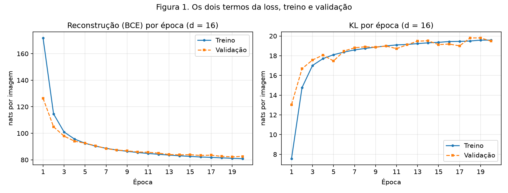
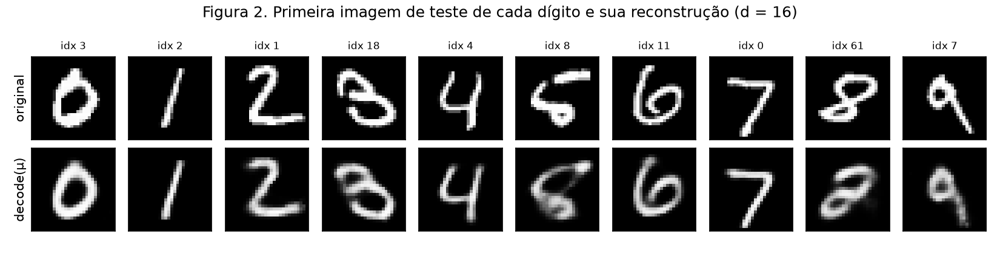
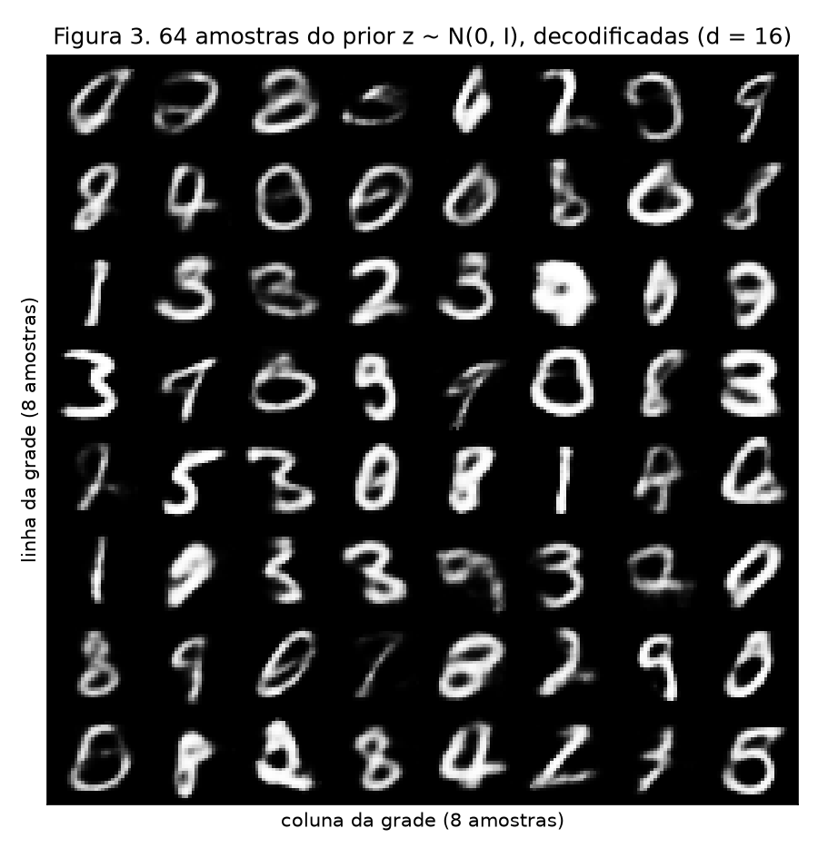
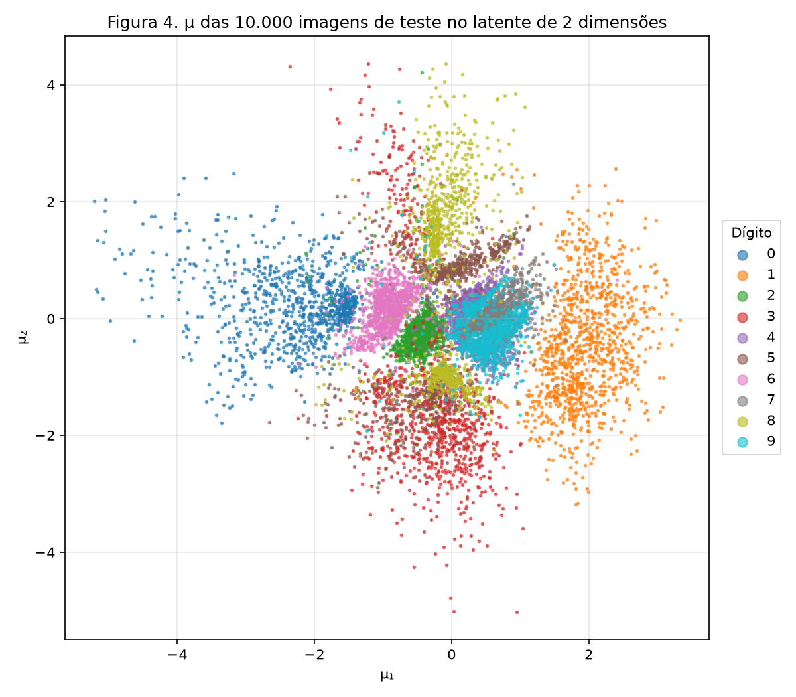
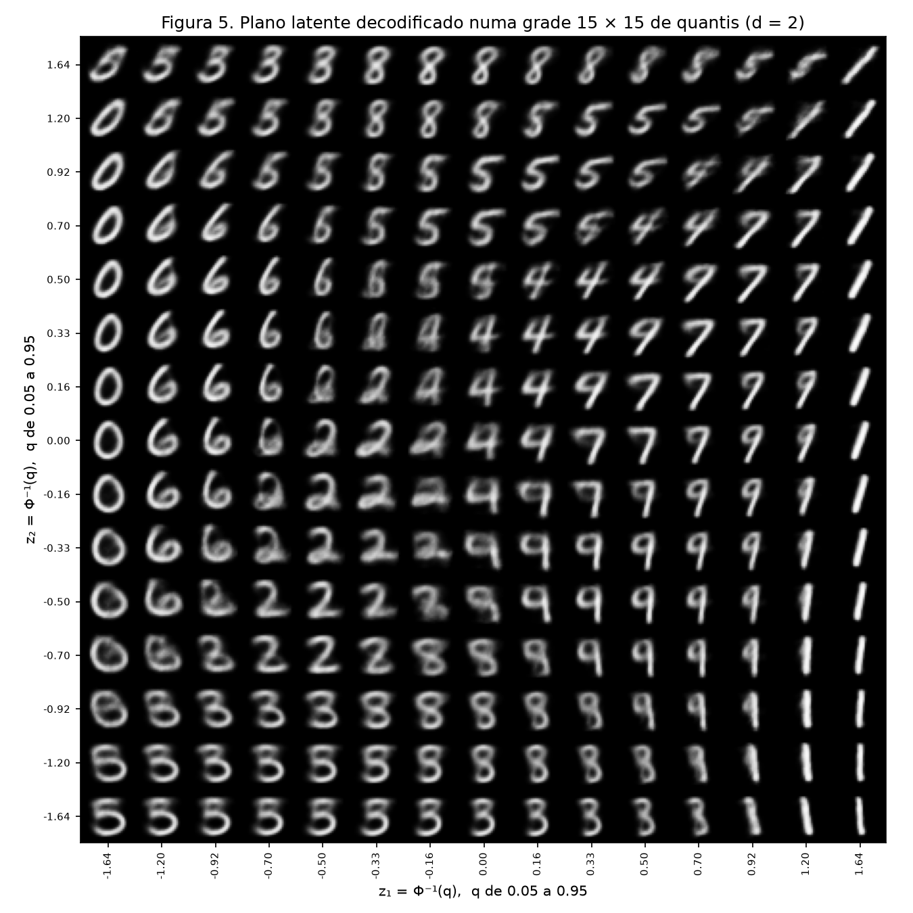
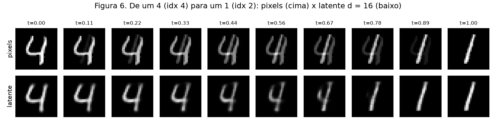

# 4. VAE

!!! abstract "Enunciado"

    [Exercises → VAE](https://insper.github.io/ann-dl/){:target='_blank'}

## Exercise 1: A VAE on MNIST

Um único script treina os dois VAEs da entrega, d = 16 (este exercício) e d = 2
(Exercício 2), com a mesma arquitetura, os mesmos dados, a mesma semente, $\beta = 1$ e o
mesmo orçamento de treino. O PyTorch entra só com as camadas lineares, o autograd e o Adam.
A reparametrização, os dois termos da loss (BCE somada sobre os pixels e KL em forma
fechada) e a amostragem do prior são escritos à mão, sem `torch.distributions` nem classes
de VAE prontas. Todas as perdas estão em **nats por imagem**: soma sobre os 784 pixels (ou
sobre as d dimensões do latente, no KL), média sobre as imagens.

`torch.manual_seed(42)` é chamado imediatamente antes de construir cada modelo, e o split
usa um gerador próprio com semente 42. O conjunto de teste só é carregado depois que os
dois modelos terminam de treinar, e serve apenas para os números finais e as figuras. Toda
decisão durante o treino olha só a validação.

O script vive em [`code/vae.py`](https://github.com/lucacm/ann-dl-2026-2/blob/main/docs/exercises/vae/code/vae.py)
e é incluído aqui pelo próprio arquivo, por trecho. Rodar
`python docs/exercises/vae/code/vae.py` a partir da raiz do repositório baixa o MNIST,
treina os dois modelos (cerca de 3 minutos em CPU), salva as 6 figuras e imprime todos os
números deste relatório.

``` { .python .copy .select linenums='1' title="docs/exercises/vae/code/vae.py" }
--8<-- "docs/exercises/vae/code/vae.py:setup"
```

### A: Load and split the data

``` { .python .copy .select linenums='1' title="docs/exercises/vae/code/vae.py" }
--8<-- "docs/exercises/vae/code/vae.py:data"
```

1.  `random_split` só depende do tamanho do conjunto e do gerador: com
    `torch.Generator().manual_seed(42)`, as mesmas 50.000 imagens caem no treino a cada
    execução.

- **Treino:** 50.000 imagens do conjunto oficial de treino.
- **Validação:** as outras 10.000 do mesmo conjunto, usadas para acompanhar os dois termos
  a cada época.
- **Teste:** as 10.000 imagens oficiais de teste, carregadas só no fim do script.

Os pixels ficam em $[0, 1]$ (`ToTensor()`), e cada imagem é achatada num vetor de 784.

### B: Build the model

``` { .python .copy .select linenums='1' title="docs/exercises/vae/code/vae.py" }
--8<-- "docs/exercises/vae/code/vae.py:model"

--8<-- "docs/exercises/vae/code/vae.py:loss"
```

1.  A segunda cabeça prevê $\log\sigma^2$, e não $\sigma$: o log não tem restrição de sinal,
    e $\sigma = e^{\frac{1}{2}\log\sigma^2}$ sai sempre positivo.

Arquitetura, com d = 16:

- **Encoder:** 784 → 512 → 256, ReLU depois de cada camada, e duas cabeças lineares
  256 → d, uma para $\mu$ e outra para $\log\sigma^2$.
- **Decoder:** d → 256 → 512 → 784, ReLU nas camadas ocultas e sigmoid na saída, de modo
  que cada saída $\hat x_j \in (0, 1)$ é a probabilidade de Bernoulli do pixel $j$.

**Reparametrização.** Amostrar $\mathbf{z} \sim \mathcal N(\mu, \operatorname{diag}\sigma^2)$
diretamente não é diferenciável. Por isso a amostra é escrita como

$$
\mathbf{z} = \mu + \sigma \odot \varepsilon,
\qquad \varepsilon \sim \mathcal N(\mathbf 0, \mathbf I),
$$

e toda a aleatoriedade fica em $\varepsilon$, que não depende de parâmetro
nenhum. O gradiente passa por $\mu$ e $\sigma$ normalmente.

**Loss por imagem** ($\beta = 1$, média sobre o lote):

$$
\mathcal L(\mathbf x) =
\underbrace{-\sum_{j=1}^{784}\big[x_j \log \hat x_j + (1 - x_j)\log(1 - \hat x_j)\big]}_{\text{reconstrução (BCE)}}
\; + \; \beta\,
\underbrace{\tfrac12 \sum_{i=1}^{d}\big(\mu_i^2 + \sigma_i^2 - 1 - \log\sigma_i^2\big)}_{\mathrm{KL}(q(\mathbf z|\mathbf x)\,\|\,\mathcal N(\mathbf 0, \mathbf I))}
$$

- **Por que BCE.** Os pixels do MNIST são quase binários: a maioria é 0 (fundo) ou perto de
  1 (traço). Uma Bernoulli por pixel descreve isso melhor que a Gaussiana implícita no erro
  quadrático da aula, e a BCE é exatamente $-\log p(\mathbf x \mid \mathbf z)$ sob essa
  Bernoulli. Somada sobre os pixels e junto com o KL, a loss é o $-$ELBO em nats.
- **Por que `reduction="sum"` dividido pelo tamanho do lote.** O KL é uma soma sobre as d
  dimensões. Com `reduction="mean"`, a BCE seria dividida também por 784, e o KL pesaria
  784 vezes mais em relação à reconstrução, o mesmo que treinar com $\beta \approx 784$.
- **KL em forma fechada.** Como $q(\mathbf z\mid\mathbf x)$ e o prior são gaussianos
  diagonais, o KL tem forma fechada e soma por dimensão. Ele está escrito linha a linha em
  `vae_loss_terms`, e não por amostragem nem por biblioteca.

### C: Train

``` { .python .copy .select linenums='1' title="docs/exercises/vae/code/vae.py" }
--8<-- "docs/exercises/vae/code/vae.py:train"
```

1.  A semente vem imediatamente antes de construir o modelo: a inicialização dos pesos
    de d = 16 e de d = 2 não depende do que rodou antes no script.
2.  Média de treino da época: cada lote pesa pelo número de imagens. É a média dos
    termos ao longo da época, com o modelo ainda mudando, e por isso sai um pouco
    pior que a validação nas primeiras épocas.
3.  A validação é avaliada com o modelo congelado ao fim de cada época, com $\mathbf z$
    amostrado como no treino, para que os dois termos sejam a mesma estimativa do ELBO.

Adam com $\eta = 10^{-3}$, lotes de 128 e 20 épocas. O treino de cada modelo leva cerca de
1,5 minuto em CPU.


/// caption
**Figura 1.** Reconstrução (esquerda) e KL (direita) por época, em nats por imagem, no
treino e na validação (d = 16).
///

Números no conjunto de teste (d = 16), em nats por imagem:

| Termo | Teste |
|-------|------:|
| Reconstrução (BCE) | **82.02** |
| KL | **19.50** |
| $-$ELBO (soma) | **101.52** |

Os valores ficam perto das referências do enunciado (cerca de 81 e 20). Na validação, o KL
sai de **13.03** nats na primeira época e termina em **19.48** na vigésima, enquanto a
reconstrução cai de 126.42 para 82.58.

### D: Reconstructions and samples

``` { .python .copy .select linenums='1' title="docs/exercises/vae/code/vae.py" }
--8<-- "docs/exercises/vae/code/vae.py:fig2"

--8<-- "docs/exercises/vae/code/vae.py:fig3"
```


/// caption
**Figura 2.** Primeira imagem de teste de cada dígito (em cima, com o índice) e a
reconstrução obtida decodificando $\mu$ (embaixo), modelo d = 16.
///


/// caption
**Figura 3.** 64 amostras $\mathbf z \sim \mathcal N(\mathbf 0, \mathbf I)$, sorteadas
depois de `torch.manual_seed(0)` e decodificadas pelo modelo d = 16.
///

### E: Analysis

**1. Por que o KL sobe enquanto a loss total cai.** No começo do treino, o encoder quase
não leva informação de $\mathbf x$ para $\mathbf z$: as posteriores ficam perto do prior, o
KL é pequeno e o decoder só consegue produzir algo como um "dígito médio", com reconstrução
ruim. Separar as imagens no latente, empurrando $\mu$ para longe de zero e
encolhendo $\sigma$, custa nats de KL, mas cada nat gasto ali compra muito mais
de um nat de reconstrução. Da época 1 para a 2, no treino, o KL sobe 7.21 nats
(7.56 → 14.77) e a reconstrução cai 57.26 (171.89 → 114.63). O total cai de 179.45 para
129.40, e o otimizador aceita o KL maior porque minimiza a soma, não cada termo. Ao longo
das 20 épocas, a validação mostra a mesma troca: +6.45 nats de KL (13.03 → 19.48) para
−43.84 de reconstrução (126.42 → 82.58). Depois da época 7 o KL praticamente estabiliza
(18.8 → 19.5), sinal de que o modelo encontrou o equilíbrio entre os dois termos.

**2. Por que a Figura 3 parece pior que a Figura 2: duas razões independentes.**

- **Onde as amostras do prior caem no latente.** O decoder foi treinado com códigos
  $\mathbf z$ tirados das posteriores $q(\mathbf z \mid \mathbf x)$ das imagens de treino.
  Essas posteriores são estreitas, com $\sigma$ médio de **0.447** contra 1 do prior, e se
  agrupam por dígito (a Figura 4 mostra isso em 2D). Juntas, elas cobrem o
  $\mathcal N(\mathbf 0, \mathbf I)$ apenas aproximadamente. A variância da mistura por
  dimensão fica entre 0.97 e 1.09, mas a mistura tem regiões densas e vales entre os
  grupos. O KL de 19.50 nats mostra que as posteriores não são o prior. Um $\mathbf z$
  sorteado do prior não sabe para onde estão os dígitos: parte das amostras cai nas
  fronteiras entre grupos ou em regiões que o decoder viu pouco, e vira um híbrido ou uma
  forma sem dígito (por exemplo, a mancha arredondada na terceira linha da Figura 3).
  Na Figura 2, por contraste, $\mu$ de uma imagem real está, por construção,
  no meio de uma região que o decoder conhece.
- **O que o decoder produz para um $\mathbf z$ dado.** O decoder não sorteia um dígito: ele
  devolve, pixel a pixel, a probabilidade de Bernoulli, ou seja, o **pixel esperado** sobre
  todas as imagens compatíveis com aquele código. Como na seção da aula sobre o borrão, o
  ótimo da verossimilhança é a média, e a média de vários traços ligeiramente deslocados é
  um traço cinza e largo. Medido como a fração de pixels "cinzas" (entre 0.1 e 0.9), o
  borrão é visível: são **8.6%** nas imagens reais de teste, **14.5%** nas reconstruções da
  Figura 2 e **17.1%** nas amostras da Figura 3. Quanto mais incerto o código, mais
  imagens diferentes cabem nele, e mais a média borra.

**3. Por que decodificar $\mu$ na Figura 2.** $\mu$ é o centro e o
ponto mais provável da posterior: é a melhor descrição que o encoder dá daquela imagem.
Um $\mathbf z$ amostrado é $\mu$ mais um ruído $\sigma \odot
\varepsilon$ ($\sigma$ médio de 0.447 por dimensão), e decodificá-lo mostra a
reconstrução de um vizinho aleatório, não a da imagem. Ela também mudaria a cada
execução. No teste, a reconstrução decodificando $\mu$ custa **76.79** nats,
contra **82.09** decodificando um $\mathbf z$ amostrado: o ruído da amostragem é útil
no treino, como regularizador, mas só atrapalha quando o objetivo é ver o que o modelo
aprendeu sobre aquela imagem.

## Exercise 2: A Latent Space You Can See

### A: Train a 2-D VAE

Mesmo código, mesma semente, mesmos dados, $\beta = 1$ e 20 épocas, mudando só
`train_vae(2)`. Comparação no conjunto de teste, em nats por imagem:

| Modelo | Reconstrução | KL | $-$ELBO |
|--------|-------------:|---:|--------:|
| d = 16 | 82.02 | 19.50 | 101.52 |
| **d = 2** | **135.33** | **6.74** | **142.07** |

Os valores de d = 2 batem com as referências do enunciado (cerca de 135 e 7). O modelo de
2 dimensões gasta menos da metade do KL (6.74 contra 19.50 nats), porque só consegue
guardar pouca informação, e paga 53.31 nats a mais de reconstrução.

### B: The encoded test set

``` { .python .copy .select linenums='1' title="docs/exercises/vae/code/vae.py" }
--8<-- "docs/exercises/vae/code/vae.py:fig4"
```


/// caption
**Figura 4.** $\mu$ das 10.000 imagens de teste no modelo d = 2, coloridas pelo
dígito verdadeiro.
///

### C: The decoded plane

``` { .python .copy .select linenums='1' title="docs/exercises/vae/code/vae.py" }
--8<-- "docs/exercises/vae/code/vae.py:fig5"
```


/// caption
**Figura 5.** Decodificação do modelo d = 2 numa grade 15 × 15, com
$z_1, z_2 = \Phi^{-1}(q)$ e $q$ em 15 valores igualmente espaçados de 0.05 a 0.95.
///

**Por que $\Phi^{-1}(q)$.** Como $\Phi$ é a função de distribuição acumulada do prior
$\mathcal N(0, 1)$, pontos $z = \Phi^{-1}(q)$ com $q$ igualmente espaçado são quantis
consecutivos, e entre dois vizinhos há sempre a mesma massa de probabilidade do prior
($\Delta q$ por eixo, $\Delta q^2$ por célula). Por isso, cada célula da grade representa
a mesma fração das amostras que o prior produziria.

Na prática, isso deixa a grade mais densa perto da origem, onde a massa do prior está
(passo de 0.16 entre os valores centrais), e mais esparsa nas bordas (passo de 0.44 entre
1.20 e 1.64).

### D: Interpolation

``` { .python .copy .select linenums='1' title="docs/exercises/vae/code/vae.py" }
--8<-- "docs/exercises/vae/code/vae.py:fig6"
```

As duas imagens interpoladas são o **índice 4** do teste (o primeiro "4") e o
**índice 2** (o primeiro "1"). A linha de baixo usa o modelo **d = 16**, decodificando
$(1-t)\mu_a + t\,\mu_b$.


/// caption
**Figura 6.** Interpolação de 10 passos, de $t = 0$ a $t = 1$, entre o teste 4 (dígito 4)
e o teste 2 (dígito 1): em pixels (em cima) e no latente do modelo d = 16 (embaixo).
///

### E: Analysis

**1. Onde os dígitos se sobrepõem.** Na Figura 4, os grupos bem separados são o **0** (à
esquerda, centróide de $\mu$ em $(-2.26, +0.24)$), o **1** (à direita,
$(+1.90, -0.45)$) e o **6**. A sobreposição forte está no aglomerado à direita do centro,
onde **4, 9 e 7** praticamente coincidem (centróides em $(+0.33, -0.03)$,
$(+0.50, -0.19)$ e $(+0.63, +0.06)$). Ela também aparece em **3, 5 e 8**, que se misturam
na faixa vertical abaixo e acima do centro. Para pôr um número nisso, um classificador
$k$-NN ($k = 15$) treinado no $\mu$ das imagens de treino acerta 79.50% do teste,
e os pares mais confundidos são **4 ↔ 9 (521 erros)**, 3 ↔ 5 (300) e 7 ↔ 9 (249).

A mesma transição aparece na Figura 5. Na faixa central de linhas
($z_2 \approx -0.33$ a $0.50$), andando de $z_1 \approx -0.16$ para $z_1 \approx 0.70$, a
grade passa de **4** para **9** e depois para **7** em uma ou duas células. As imagens no
meio do caminho são híbridos plausíveis: um 4 cujo topo se fecha num laço (já meio 9) e um
9 cuja haste se inclina e cujo laço se abre (já meio 7). Na parte de baixo da grade
($z_2 \approx -1.20$ a $-1.64$), o mesmo acontece entre **5 e 3**: em torno de
$z_1 \approx -0.33$, o traço de cima do 5 vira o arco de cima do 3. Nenhuma dessas células
é um borrão sem sentido: o decoder interpola entre formas que de fato se parecem, e é
exatamente porque se parecem que o encoder as colocou juntas.

**2. O que d = 2 obriga o modelo a descartar.** Com só dois números por imagem, o código
cabe para dizer **qual dígito** é e um ou dois traços de **estilo grosso**, como inclinação
e largura. Na Figura 5, cada dígito ocupa uma região com poucas variações: os 1 da coluna
da direita mudam quase só de inclinação, e os 0 da coluna da esquerda são praticamente
todos o mesmo 0 arredondado. Tudo o que distingue uma escrita de outra dentro do mesmo
dígito se perde: espessura irregular do traço, laços abertos ou fechados no 2, a barra no
meio do 7, ganchos e serifas. O decoder devolve o "protótipo" daquela região. Em números,
a reconstrução de teste sobe de 82.02 para **135.33 nats** (+53.31), e o modelo só
consegue usar 6.74 nats de informação sobre cada imagem, contra 19.50 do modelo d = 16.

**3. Pixels × latente na Figura 6.** A **linha latente** passa por imagens com forma de
dígito: o 4 vai ficando mais estreito, perde o braço esquerdo e vira um traço vertical
inclinado, o 1, sempre com um único traço nítido. A **linha de pixels** não passa por
dígitos: cada imagem do meio é o 4 e o 1 **sobrepostos em transparência**, dois traços com
metade da intensidade cada. A fração de pixels cinzas (entre 0.1 e 0.9) mede isso: na
linha de pixels ela sobe de 7.8% em $t = 0$ para **18.6%** perto de $t = 0.44$, e depois
desce de novo para 4.8%. Na linha latente, ela fica entre 5.9% e 15.2% o tempo todo,
sem pico no meio: passa de um nível para o outro sem atravessar uma sobreposição. A diferença está em onde cada caminho anda. As imagens de dígitos
ocupam uma "superfície" fina e curva dentro do espaço de 784 pixels, e a média de dois
pontos dessa superfície cai fora dela. O latente do VAE foi treinado para que pontos
próximos decodifiquem imagens parecidas, então a reta entre $\mu_a$ e
$\mu_b$ é mapeada pelo decoder de volta para dentro da região dos dígitos.

## Discussão

O que mais me surpreendeu no treino de d = 16 foi o KL por dimensão. Das 16 dimensões do
latente, **5 ficaram com KL praticamente zero**: o encoder as ignora, devolvendo
exatamente o prior, e o modelo usa só **11**. É o colapso da posterior que a aula descreve,
mas parcial, e por dimensão. Com $\beta = 1$ e só 20 épocas, codificar informação numa
dimensão a mais não compensava o custo em KL. Não é um defeito a corrigir aqui (o enunciado
fixa $\beta$ e o orçamento), mas mostra que d = 16 é mais latente do que este modelo
consegue usar.

Também vale notar que a reconstrução de validação fica abaixo da de treino nas primeiras
épocas (126.42 contra 171.89 na época 1). Isso não é vazamento: o número de treino é a
média da época inteira, com o modelo ainda melhorando, e o de validação é medido com o
modelo do fim da época. A partir da época 6, as curvas praticamente coincidem, e no fim a
validação fica 1.7 nat acima do treino (82.58 contra 80.86), sem sinal de overfitting
relevante.

Por fim, a reprodutibilidade: com as sementes fixas, rodar o script duas vezes dá
exatamente os mesmos números. A interpolação usa o primeiro 4 e o primeiro 1 do teste,
escolhidos antes de ver o resultado, para evitar escolher um par que favorecesse a
conclusão.

## Conclusão

A loss do VAE é uma troca, e registrar os dois termos separadamente é o que a torna
visível. O modelo aceita ~20 nats de KL para derrubar a reconstrução de 172 para 81 nats
no treino. Com essa informação no latente, as reconstruções ficam boas, mas as amostras
do prior ficam piores, porque o prior não sabe onde estão os dígitos e porque o decoder
devolve uma média borrada. Com d = 2, a troca fica explícita: o latente é visível e
organizado por semelhança, a ponto de as fronteiras 4 ↔ 9 ↔ 7 e 3 ↔ 5 aparecerem tanto
no encoder quanto no decoder, mas cada imagem custa 53 nats a mais de reconstrução. O que
o latente ganha, comparado ao espaço de pixels, a interpolação mostra: andar em linha reta
nele percorre dígitos, enquanto a mesma reta nos pixels só sobrepõe duas imagens.

## Results summary

| # | Quantity | Value |
|---|----------|-------|
| 1 | Ex. 1: test reconstruction, KL, and negative ELBO (d = 16) | 82.02, 19.50, 101.52 nats por imagem |
| 2 | Ex. 1: validation KL at the first and last epoch | 13.03 (época 1), 19.48 (época 20) nats |
| 3 | Ex. 2: test reconstruction and KL (d = 2) | 135.33, 6.74 nats por imagem |
| 4 | Ex. 2: the two test indices interpolated | 4 (dígito 4) e 2 (dígito 1) |
