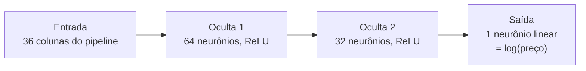
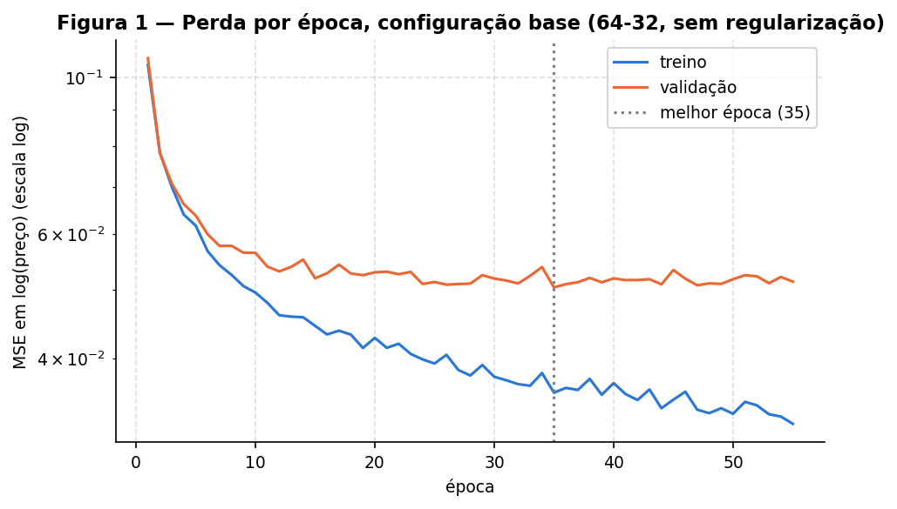
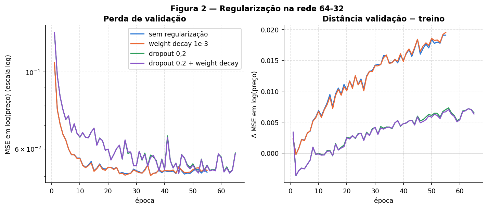
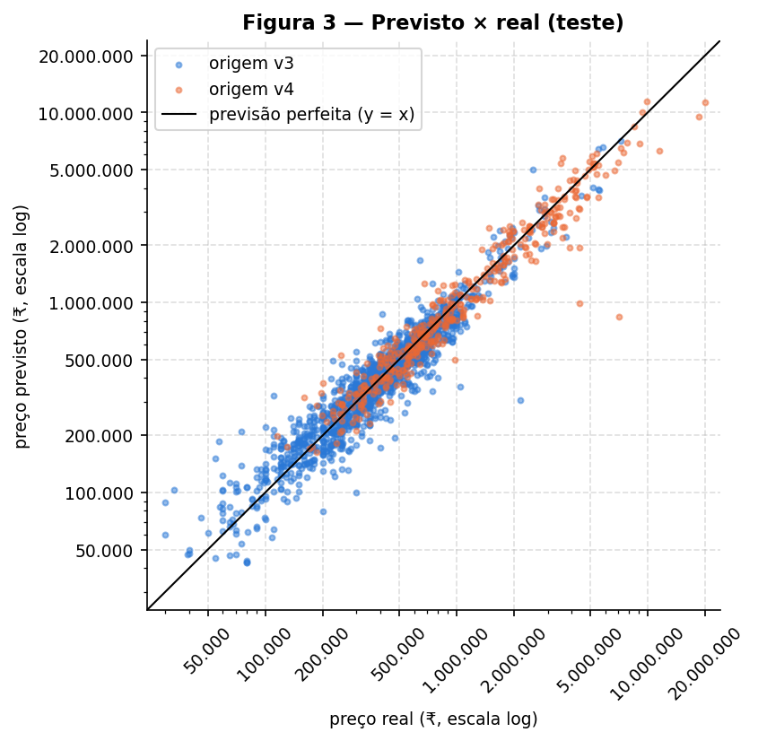
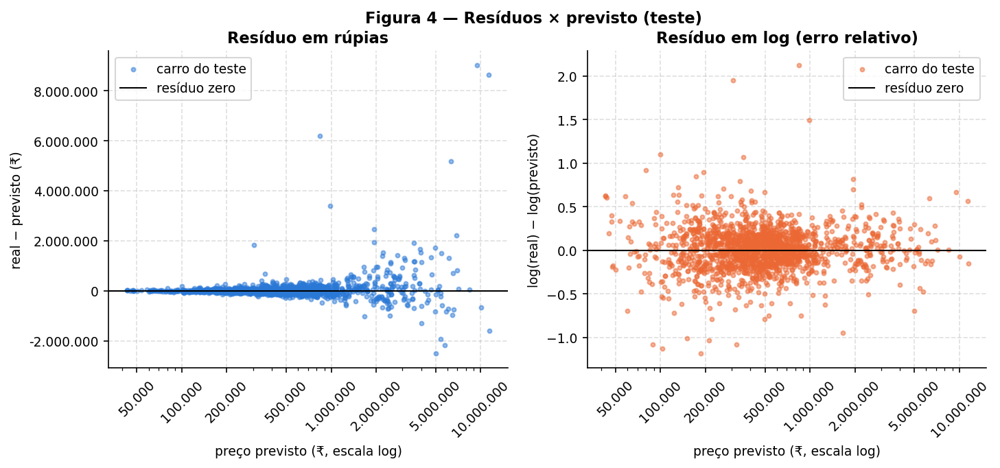
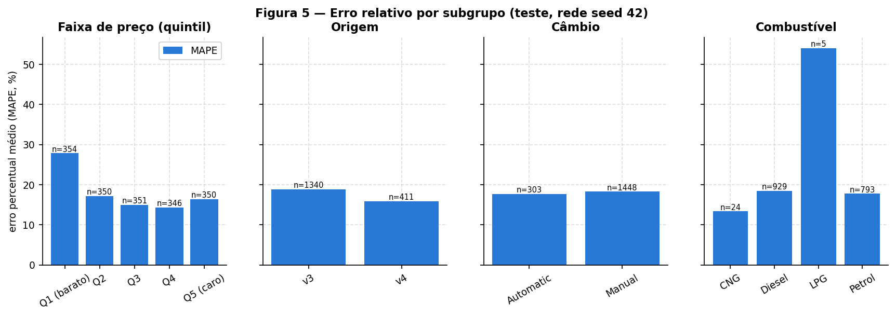
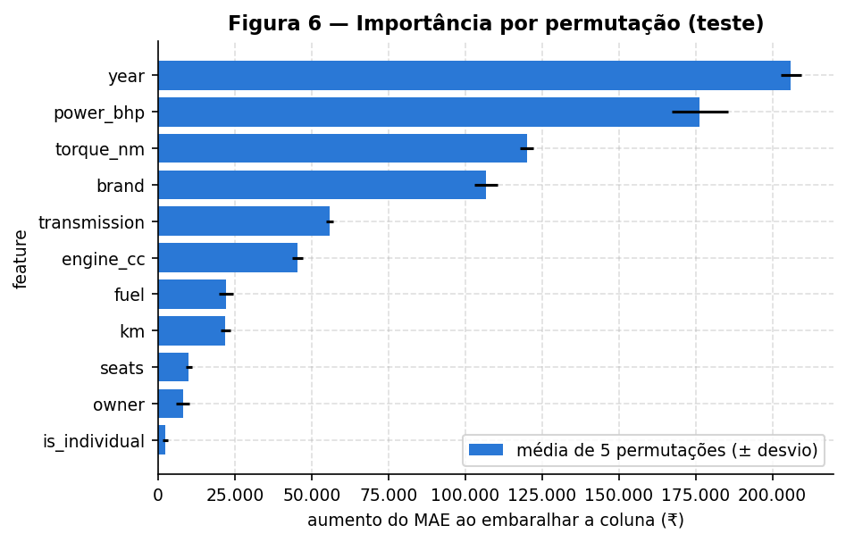

# 2. Regressão

!!! abstract "Entrega 2 de 2 do [Projeto](../index.md)"

    [Projects → Classification or Regression](https://insper.github.io/ann-dl/){:target='_blank'}

!!! info "Equipe"

    | Nome completo | GitHub |
    |---------------|--------|
    | Luca Cazzolato Machado | [@lucacm](https://github.com/lucacm) |
    | Gabriel Cavarsan | [@Gabriel-Cavarsan](https://github.com/Gabriel-Cavarsan) |
    | Gabriel Gerner Maggion | [@gabrielgmaggion-dot](https://github.com/gabrielgmaggion-dot) |

    Dataset, decisões e status: [página do projeto](../index.md).

!!! example "Como reproduzir"

    1. Baixe o dataset [Vehicle dataset (CarDekho)](https://www.kaggle.com/datasets/nehalbirla/vehicle-dataset-from-cardekho){:target='_blank'}
       e descompacte os **4 arquivos `.csv`** em `docs/projects/eda/code/data/` (a mesma
       pasta da Entrega 1).
    2. Instale as dependências: `python3 -m pip install -r requirements.txt`.
    3. Na raiz do repositório, rode `python docs/projects/regression/code/regression.py`.

    O script leva cerca de 1 minuto na CPU, regenera as 6 figuras em `figures/` e imprime
    todos os números citados nesta página. As seeds são fixas, então duas execuções dão
    exatamente o mesmo resultado.

**A tarefa em uma frase:** prever o **preço pedido** num anúncio de carro usado (em rúpias, ₹)
a partir de 11 características do carro, com uma rede neural, e medir com honestidade se ela
é melhor que modelos mais simples.

Os dados, a limpeza, o split e o pré-processamento são os da [Entrega 1 (EDA)](../eda/index.md),
importados do mesmo código, sem cópia. O resumo do dataset está na [página do projeto](../index.md#dataset).

## 0. Ponto de partida

!!! question "O que é e por que fazemos"

    Antes de treinar, fixamos **com que dados** o modelo aprende e **como vamos julgá-lo**.
    Se a régua fosse escolhida depois de ver o resultado, seria fácil se enganar e escolher a
    régua que favorece o modelo.

``` { .python .copy .select linenums='1' title="docs/projects/regression/code/regression.py" }
--8<-- "docs/projects/regression/code/regression.py:setup"
```

**Os dados.** `load_dataset()` e `split()` vêm de `docs/projects/eda/code/cardekho.py`, o
módulo da Entrega 1. Isso garante o **mesmo dataset** (8754 carros, v3 + v4 deduplicados),
o **mesmo split 80/20** e a **mesma seed (42)** do EDA: 7003 carros para treino e 1751 para teste.

**Três conjuntos, três papéis.**

| Conjunto | Linhas | Para que serve |
|---|---:|---|
| Treino | **5602** | a rede aprende os pesos aqui |
| Validação | **1401** | escolher entre modelos e decidir quando parar de treinar |
| Teste | **1751** | nota final, aberto **uma única vez**, no passo 5 |

/// caption
**Tabela 1.** Divisão dos dados. A validação é 20% do treino do EDA (estratificada por
origem v3/v4), e o teste é exatamente o mesmo do EDA.
///

Uma analogia: o treino são os exercícios resolvidos, a validação é o simulado e o teste é a
prova. Quem estuda pela prova (ou seja, usa o teste para escolher o modelo) tira uma nota
que não vale nada.

**Pipeline sem vazamento.** `build_preprocess()` é o `ColumnTransformer` do
[EDA (4C)](../eda/index.md#4c-pipeline), com todas as correções de lá: mediana com indicador
de ausência, corte nos quantis 0,5%/99,5%, log nas colunas assimétricas, padronização e
one-hot com as marcas raras agrupadas. Ele é ajustado (`fit`) **só nas 5602 linhas de
treino**, e a validação e o teste só passam pelo `transform`. A prova está na saída do script:
a média das colunas padronizadas é 0,0000 no treino e 0,0137 na validação. Se a validação
tivesse participado do ajuste, as duas seriam zero.

O pipeline gera **36 colunas** (no EDA eram 37). A diferença é uma marca: a Volvo tem 21
anúncios no treino completo e 19 no nosso treino de 5602 linhas, abaixo do corte de 20, e
por isso passa para o grupo "marcas raras". Isso confirma que as categorias são aprendidas
só com o treino.

**O alvo.** A rede aprende **log(preço)**, como decidido no
[EDA (1C)](../eda/index.md#1c-alvo): o preço vai de 30 mil a 35 milhões de ₹ (assimetria
8,39), e em log a assimetria cai para 0,43. Todas as métricas são calculadas **depois de
desfazer o log** (`np.exp`), ou seja, em rúpias:

``` { .python .copy .select linenums='1' title="docs/projects/regression/code/regression.py" }
--8<-- "docs/projects/regression/code/regression.py:metrics"
```

| Métrica | O que mede, em palavras simples |
|---|---|
| **MAE** | em média, quantas rúpias a previsão erra (para mais ou para menos) |
| **RMSE** | parecido com o MAE, mas eleva os erros ao quadrado: um erro grande pesa muito mais |
| **MAPE** | erro médio em **porcentagem** do preço real. Errar 50 mil num carro de 100 mil é 50% |
| **R²** | fração da variação dos preços que o modelo explica: 1 é perfeito, 0 é o mesmo que chutar a média |

/// caption
**Tabela 2.** Métricas usadas. O MAPE é seguro aqui porque o menor preço do dataset é
29.999 ₹, longe de zero (com preço perto de zero, a divisão explodiria).
///

**Métrica principal e critério de sucesso** (definidos antes de treinar):

- **Métrica principal: MAE em rúpias.** É a mais fácil de explicar ("erra em média X ₹") e
  menos sensível que o RMSE aos poucos carros de luxo.
- **Critério: a rede só "vale a pena" se o MAE de teste for pelo menos 15% menor que o do
  melhor baseline** (o baseline escolhido na validação, no passo 1).

## 1. Baselines

!!! question "O que é e por que fazemos"

    Um **baseline** é um modelo propositalmente simples que serve de régua. Uma rede neural
    só faz sentido se for **claramente melhor** que ele. Se não for, ela só trouxe
    complexidade.

``` { .python .copy .select linenums='1' title="docs/projects/regression/code/regression.py" }
--8<-- "docs/projects/regression/code/regression.py:baselines"
```

- **Dummy (mediana):** ignora o carro e prevê sempre o mesmo preço, a mediana do treino
  (475.000 ₹). É o "chute" de quem não sabe nada.
- **Ridge:** regressão linear (uma soma ponderada das 36 colunas) com uma pequena penalidade
  nos pesos (`alpha=1`) para lidar com as colunas redundantes do bloco técnico (motor,
  potência e torque, com ρ até 0,86 no [EDA](../eda/index.md#3a-numerica-numerica)). Usa o
  **mesmo pipeline e o mesmo treino** da rede.

| Modelo | MAE | RMSE | MAPE | R² |
|---|---:|---:|---:|---:|
| Dummy (mediana) | 515.640 ₹ | 1.524.152 ₹ | 84,9% | −0,045 |
| Ridge (alpha=1) | **184.309 ₹** | 1.007.515 ₹ | 20,2% | 0,543 |

/// caption
**Tabela 3.** Baselines na **validação** (1401 carros).
///

**Como ler:**

- O Dummy erra em média 516 mil ₹ (85% do preço), e seu R² é negativo, pior que prever a
  média. É o piso.
- O Ridge já reduz o MAE em **64%** (de 515.640 para 184.309 ₹) e o MAPE para 20%: as features
  têm muito sinal, e boa parte dele é **linear em log**. Isso faz sentido, porque
  "log(preço) = soma de efeitos" equivale a "o preço é um produto de fatores" (ano ×
  marca × potência...).
- O R² de 0,543 do Ridge é bem menor do que o MAPE sugere: o R² em rúpias é dominado pelos
  poucos carros muito caros, onde um modelo linear em log erra muitas rúpias.

**O melhor baseline é o Ridge.** É ele que a rede precisa superar em 15%.

## 2. A rede

!!! question "O que é e por que fazemos"

    Uma **MLP** (*multilayer perceptron*) é uma sequência de camadas. Cada neurônio faz uma
    soma ponderada das entradas e passa o resultado por uma função não linear (a
    *ativação*). Empilhar camadas permite aprender **interações**, coisas como "o km importa
    de um jeito diferente conforme o ano", que um modelo linear como o Ridge não consegue
    representar.

``` { .python .copy .select linenums='1' title="docs/projects/regression/code/regression.py" }
--8<-- "docs/projects/regression/code/regression.py:model"
```

A rede **base** (usada nos passos 3 e 4) tem a forma abaixo. A configuração final, escolhida
no passo 4, tem a mesma forma, só que mais larga (128 → 64).



| | Escolha | Por quê |
|---|---|---|
| Camadas ocultas | **2** | uma camada já aprende interações. Duas dão folga para combinações como ano × km × combustível (o paradoxo de Simpson do [EDA](../eda/index.md#3a-numerica-numerica)) sem virar uma rede "profunda" difícil de treinar em ~5 mil linhas |
| Larguras | **64 → 32** (base) | funil: a primeira camada combina as 36 entradas em 64 "características", e a segunda resume em 32. São potências de 2 por convenção, e a largura em si é testada no passo 4 (32-16, 64-32 e 128-64) |
| Ativação | **ReLU**, `max(0, z)` | simples e rápida. Para valores positivos a derivada é sempre 1, então não **satura** como tanh e sigmoide (que achatam e matam o gradiente) |
| Inicialização | **Kaiming/He normal**, bias 0 | sorteia os pesos com variância 2/(n entradas), a escala certa para ReLU: o sinal não encolhe nem explode de camada em camada |
| Bias da saída | começa na **média de log(preço) do treino** (≈ 13) | sem isso, a rede gastaria as primeiras épocas só "subindo" a saída de 0 até 13. Assim, ela começa prevendo o preço médio e aprende só as diferenças |
| Saída | **1 neurônio linear**, sem ativação | log(preço) pode ser qualquer número real. Uma ativação na saída (ReLU, sigmoide) cortaria valores possíveis |
| Perda | **MSE em log(preço)** | ver abaixo |

/// caption
**Tabela 4.** Arquitetura e justificativas.
///

**Por que MSE, e não MAE ou Huber?** O enunciado pede que a escolha considere os outliers do
EDA. Em rúpias, o preço tem assimetria 8,39, e a MSE seria dominada pelos poucos carros de
milhões, um caso para Huber ou MAE. Mas a rede aprende em **log**, onde a assimetria é 0,43
e os carros de luxo deixam de ser outliers extremos. Além disso, um erro em log é um erro
**relativo**: errar 10% num carro de 2 lakh custa o mesmo que errar 10% num de 50 lakh.
Com o problema dos outliers já resolvido pelo log, a MSE (a perda mais simples, e a que
corresponde ao RMSE que reportamos) é suficiente.

**Parâmetros × linhas.** A rede base tem 36·64+64 + 64·32+32 + 32·1+1 = **4.481 parâmetros**
para **5.602 linhas** de treino (razão 0,80). Com menos parâmetros que exemplos, ela tem pouca
folga para decorar o treino. A rede final (128-64) tem **13.057 parâmetros**, 2,3× o número
de linhas. Nesse caso, quem segura o *overfitting* é o early stopping (passo 3), e a
validação confirma que ela generaliza (passo 4).

A rede e o loop de treino estão em `code/regression.py`, em PyTorch.

## 3. Treino

!!! question "O que é e por que fazemos"

    Treinar é repetir: mostrar um lote de carros à rede, medir o erro (a perda), calcular
    em que direção mexer cada peso para o erro cair (o gradiente, via *backpropagation*) e
    dar um pequeno passo nessa direção. Uma **época** é uma passada por todo o treino.

``` { .python .copy .select linenums='1' title="docs/projects/regression/code/regression.py" }
--8<-- "docs/projects/regression/code/regression.py:train"
```

| | Escolha | Por quê |
|---|---|---|
| Otimizador | **AdamW** | o Adam ajusta o tamanho do passo de cada peso sozinho, então funciona bem sem muita sintonia. O AdamW é o Adam com o *weight decay* separado, o que permite testar essa regularização no passo 4 (com `weight_decay=0` ele é exatamente o Adam) |
| Learning rate | **1e-3** | o valor padrão do Adam, que costuma funcionar. A curva da Figura 1 cai rápido e sem oscilar, então não foi preciso mudar |
| Batch size | **64** | meio-termo: lotes pequenos dão gradiente ruidoso, e lotes grandes atualizam pouco por época. Com 5602 linhas, são 88 atualizações por época |
| Épocas | **até 300**, com **early stopping** (paciência 20) | o teto é só uma segurança. Quem decide quando parar é a validação: se a perda de validação passa 20 épocas sem melhorar, o treino para e **os pesos da melhor época são restaurados** |
| Seeds | `torch.manual_seed(seed)` e um gerador próprio para embaralhar os lotes | o mesmo resultado a cada execução |

/// caption
**Tabela 5.** Escolhas do treino.
///


/// caption
**Figura 1.** Perda (MSE em log(preço)) de treino e validação por época, na rede base
64-32 sem regularização. A linha pontilhada marca a melhor época de validação.
///

**Como ler a Figura 1:**

- **Convergência rápida.** Na época 1 a perda de validação é 0,106. Na época 10 já é 0,056,
  quase o valor final. A maior parte do aprendizado acontece nas primeiras 10 épocas.
- **Onde começa o overfitting.** Até a época ~10 as duas curvas descem juntas. Depois, o
  treino continua caindo (0,050 na época 10 → 0,032 na 55), mas a validação **estaciona** em
  torno de 0,051–0,053. A partir daí, o que a rede aprende a mais é específico do treino
  (decoreba), e a distância entre as curvas cresce.
- **Early stopping.** A melhor validação foi na **época 35** (MSE 0,0504, contra 0,0358 no
  treino). O treino seguiu até a época 55 sem melhorar e parou. Os pesos da época 35 foram
  restaurados.
- **O que a distância diz.** Na melhor época, a validação erra cerca de 40% mais que o treino
  (0,0504 contra 0,0358). A rede tem capacidade de sobra para este dataset, e por isso o
  passo 4 testa regularização.

Como referência, um MSE de 0,05 em log é um erro típico (a raiz) de √0,05 ≈ 0,22 em log,
ou seja, cerca de 22% do preço. Na validação, essa rede base tem MAE de 150.120 ₹ e MAPE de
17,4%.

**Dificuldades.** O treino foi estável: sem perda explodindo, sem perda parada e sem
oscilação. Cada época leva cerca de 32 ms na CPU (a rede base inteira treina em 1,8 s).
Os dois cuidados que evitaram problemas foram tomados antes de treinar: o alvo em log
(sem ele, a escala de 30 mil a 35 milhões tornaria a MSE instável) e o bias da saída
começando na média.

## 4. Regularização e hiperparâmetros

!!! question "O que é e por que fazemos"

    **Regularização** é qualquer técnica que dificulta a rede decorar o treino, para ela
    acertar mais em carros que nunca viu. Testamos duas:

    - **Weight decay:** a cada passo, todos os pesos encolhem um pouco em direção a zero. Pesos
      menores dão uma função mais "suave", menos ajustada a cada exemplo.
    - **Dropout:** em cada lote, 20% dos neurônios ocultos são desligados ao acaso. A rede não
      pode depender de nenhum neurônio específico e precisa espalhar o que aprende. Só vale no
      treino: na avaliação todos os neurônios ficam ligados.

    Os **hiperparâmetros** são as escolhas que não são aprendidas (largura, dropout...). Para
    escolhê-los, treinamos várias combinações e ficamos com a de **menor MAE na validação**.

``` { .python .copy .select linenums='1' title="docs/projects/regression/code/regression.py" }
--8<-- "docs/projects/regression/code/regression.py:search"
```

A grade cruza 3 larguras × 2 valores de dropout × 2 valores de weight decay = **12
configurações**. Para cada largura, ela já contém as quatro variantes: sem regularização, só
weight decay, só dropout e as duas juntas. Todas usam o mesmo treino, a mesma seed e o mesmo
early stopping. A grade foi fixada antes de rodar e não foi alterada depois.

| # | Camadas | Dropout | Weight decay | Parâmetros | MAE | RMSE | MAPE | R² | Melhor época |
|---:|---|---:|---:|---:|---:|---:|---:|---:|---:|
| **1** | **128-64** | **0** | **0** | **13.057** | **146.303 ₹** | **616.805 ₹** | **16,69%** | **0,829** | **25** |
| 2 | 128-64 | 0 | 1e-3 | 13.057 | 146.532 ₹ | 621.197 ₹ | 16,68% | 0,826 | 25 |
| 3 | 32-16 | 0 | 1e-3 | 1.729 | 146.881 ₹ | 695.496 ₹ | 17,01% | 0,782 | 48 |
| 4 | 32-16 | 0 | 0 | 1.729 | 147.085 ₹ | 713.816 ₹ | 16,69% | 0,771 | 49 |
| 5 | 128-64 | 0,2 | 0 | 13.057 | 148.824 ₹ | 670.411 ₹ | 16,90% | 0,798 | 52 |
| 6 | 128-64 | 0,2 | 1e-3 | 13.057 | 148.834 ₹ | 683.362 ₹ | 16,81% | 0,790 | 52 |
| 7 | 64-32 | 0 | 0 | 4.481 | 150.120 ₹ | 669.516 ₹ | 17,41% | 0,798 | 35 |
| 8 | 64-32 | 0 | 1e-3 | 4.481 | 150.764 ₹ | 683.338 ₹ | 17,41% | 0,790 | 35 |
| 9 | 64-32 | 0,2 | 1e-3 | 4.481 | 152.052 ₹ | 777.102 ₹ | 17,34% | 0,728 | 45 |
| 10 | 64-32 | 0,2 | 0 | 4.481 | 152.211 ₹ | 778.863 ₹ | 17,39% | 0,727 | 45 |
| 11 | 32-16 | 0,2 | 1e-3 | 1.729 | 156.942 ₹ | 846.611 ₹ | 18,12% | 0,678 | 45 |
| 12 | 32-16 | 0,2 | 0 | 1.729 | 157.417 ₹ | 847.958 ₹ | 18,15% | 0,677 | 45 |

/// caption
**Tabela 6.** As 12 configurações, ordenadas pelo MAE de **validação** (a métrica principal).
Todas superam o Ridge da validação (184.309 ₹).
///

| Regularização | MAE médio (3 larguras) | MAPE médio | Época de parada média |
|---|---:|---:|---:|
| nenhuma | 147.836 ₹ | 16,93% | 36 |
| só weight decay 1e-3 | 148.059 ₹ | 17,03% | 36 |
| só dropout 0,2 | 152.817 ₹ | 17,48% | 47 |
| dropout + weight decay | 152.609 ₹ | 17,42% | 47 |

/// caption
**Tabela 7.** Efeito de cada técnica contra nenhuma, com a média das 3 larguras da Tabela 6.
///


/// caption
**Figura 2.** As quatro variantes de regularização na rede 64-32. À esquerda, a perda de
validação. À direita, a distância entre validação e treino (quanto maior, mais *overfitting*).
///

**Como ler:**

- **Weight decay de 1e-3 praticamente não fez nada.** As curvas azul e laranja da Figura 2
  se sobrepõem, e o MAE muda menos de 0,5%. O motivo é a escala: no AdamW, cada passo
  encolhe os pesos em lr × wd = 0,001 × 0,001 = 0,0001%. Em ~25–50 épocas (2 a 4 mil passos),
  isso dá uma redução de menos de 0,5% nos pesos, pequena demais para mudar a rede.
- **Dropout reduziu o overfitting, mas não melhorou a validação.** Na Figura 2 (direita), a
  distância validação − treino cai de ~0,019 para ~0,007: o dropout cumpre o papel de impedir
  a decoreba. Só que a perda de validação fica igual ou um pouco pior (MAE médio de +5 mil ₹,
  Tabela 7) e o treino demora mais (47 contra 36 épocas). Com ~5,6 mil linhas e uma rede
  pequena, o early stopping já contém o overfitting, e o ruído extra do dropout custa mais do
  que ajuda. Nas redes menores (32-16) o prejuízo é maior, porque desligar 20% de 16 neurônios
  tira capacidade demais.
- **Largura:** a rede maior (128-64) ficou em 1º lugar, e a menor sem dropout (32-16) logo
  atrás. Não há uma tendência limpa de "maior é melhor".

**Configuração escolhida: 128-64, sem dropout, sem weight decay** (MAE de validação de
146.303 ₹). Uma ressalva honesta: as 4 primeiras configurações estão a menos de 800 ₹ uma da
outra (0,5%), e no passo 5 a mesma configuração varia ±3.342 ₹ só por trocar a seed. Na
prática, elas **empatam**. A regra fixada antes ("menor MAE de validação") escolhe a 1ª,
e é ela que vai para o teste.

## 5. Avaliação no teste

!!! question "O que é e por que fazemos"

    É a **prova final**: o teste (1751 carros que nunca influenciaram nenhuma decisão) é
    usado **uma única vez**, agora. Treinamos a configuração escolhida com **3 seeds
    diferentes** porque o resultado de uma rede depende do sorteio inicial dos pesos e da
    ordem dos lotes. A média ± desvio mostra o resultado típico e quanto ele varia.

``` { .python .copy .select linenums='1' title="docs/projects/regression/code/regression.py" }
--8<-- "docs/projects/regression/code/regression.py:test"
```

A rede 128-64 é retreinada com as seeds 42, 43 e 44 no mesmo treino e com o mesmo early
stopping na validação. Ela parou nas épocas 25, 25 e 13. Nada foi escolhido olhando o teste:
a grade, a configuração e o critério já estavam fixados.

| Modelo | MAE | RMSE | MAPE | R² |
|---|---:|---:|---:|---:|
| Dummy (mediana) | 516.232 ₹ | 1.273.033 ₹ | 86,2% | −0,065 |
| Ridge (alpha=1) | 172.727 ₹ | 616.566 ₹ | 21,1% | 0,750 |
| **MLP 128-64** (3 seeds) | **145.337 ± 5.584 ₹** | **490.450 ± 42.725 ₹** | **18,1 ± 0,3%** | **0,841 ± 0,028** |

/// caption
**Tabela 8.** Rede × baselines no **teste**. Para a rede, média ± desvio padrão das 3 seeds
(MAE de 140.044, 144.796 e 151.172 ₹).
///

**O critério foi atingido, por pouco.** O MAE da rede (145.337 ₹) é **15,9% menor** que o do
Ridge (172.727 ₹), e a meta era 15%. A margem é pequena: por seed, as reduções são de 18,9%,
16,2% e **12,5%**, então a seed 44 sozinha **não** atingiria o critério. A conclusão honesta é
que a rede supera o Ridge de forma consistente (as 3 seeds ganham dele em todas as métricas),
mas com uma folga em torno do limite que tínhamos estabelecido. Em relação ao Dummy, o MAE cai
71,8%, o mesmo baseline de 516.232 ₹ que o EDA calculou.

| Métrica | Treino | Validação | Teste |
|---|---:|---:|---:|
| MAE | 113.529 ± 7.364 ₹ | 147.992 ± 3.342 ₹ | 145.337 ± 5.584 ₹ |
| RMSE | 388.092 ± 57.778 ₹ | 653.698 ± 32.843 ₹ | 490.450 ± 42.725 ₹ |
| MAPE | 14,3 ± 0,4% | 16,8 ± 0,3% | 18,1 ± 0,3% |
| R² | 0,917 ± 0,025 | 0,807 ± 0,019 | 0,841 ± 0,028 |

/// caption
**Tabela 9.** A rede escolhida nos três conjuntos (média ± desvio das 3 seeds).
///

**Como ler a Tabela 9:**

- **Treino melhor que validação e teste** (MAPE de 14,3% contra 16,8% e 18,1%): o
  overfitting de sempre, moderado, contido pelo early stopping.
- **Validação ≈ teste no MAE** (148 mil contra 145 mil): o modelo não foi "sintonizado demais"
  para a validação, e o número de teste é confiável.
- O R² e o RMSE do teste são *melhores* que os da validação, enquanto o MAPE é pior. Isso
  acontece porque o RMSE e o R² em rúpias são dominados por **poucos carros caríssimos**,
  e quais deles caem em cada conjunto é questão de sorte. O MAPE e o MAE são mais estáveis.


/// caption
**Figura 3.** Previsto × real no teste (rede seed 42), em escala log, com cores por origem.
Sobre a diagonal, a previsão é perfeita.
///

**Como ler a Figura 3:** os pontos seguem a diagonal em toda a faixa, de 30 mil a 20 milhões
de ₹. A rede acerta a **ordem de grandeza** tanto nos carros populares quanto nos de luxo,
que era o desafio apontado no EDA. A nuvem é mais larga embaixo, à esquerda: nos carros
baratos, o erro *relativo* é maior (passo 6). Há alguns pontos isolados muito abaixo da
diagonal (carros caros previstos baratos), analisados no passo 6.


/// caption
**Figura 4.** Resíduo (real − previsto) contra o previsto no teste. À esquerda, em rúpias.
À direita, em log (erro relativo).
///

**Como ler a Figura 4:**

- **Em rúpias (esquerda), o resíduo abre em leque:** o desvio do resíduo vai de 56.726 ₹
  (previsto < 300 mil) a 254.740 ₹ (300 mil – 1 milhão) e 885.631 ₹ (1–10 milhões). Errar
  10% num carro de 10 milhões é 1 milhão de rúpias.
- **Em log (direita), o leque some:** o desvio fica entre 0,23 e 0,30 em todas as faixas, e
  a média é 0,015, praticamente zero (sem viés para cima ou para baixo). Ou seja, o erro é
  **proporcional ao preço**. Isso confirma que treinar em log foi a escolha certa, como o
  template sugere para um leque.
- Não há curva nem padrão visível nos resíduos em log: o modelo não deixou uma tendência
  sistemática para trás. O que sobra parece ser ruído, ou informação que as 11 features não
  têm.

## 6. Análise de erro

!!! question "O que é e por que fazemos"

    Uma métrica global esconde **onde** o modelo erra. Separamos o erro por grupos de carros
    (os riscos que o EDA apontou), olhamos os piores casos e medimos de que features a rede
    depende. Usamos as previsões de teste da rede seed 42, e **nada é escolhido a partir
    desta seção**: é diagnóstico.

``` { .python .copy .select linenums='1' title="docs/projects/regression/code/regression.py" }
--8<-- "docs/projects/regression/code/regression.py:errors"
```


/// caption
**Figura 5.** MAPE por subgrupo no teste. O `n` acima de cada barra é o número de carros.
///

| Subgrupo | n | MAE | MAPE |
|---|---:|---:|---:|
| Q1, barato (30–245 mil ₹) | 354 | 38.645 ₹ | **27,8%** |
| Q2 (245–390 mil ₹) | 350 | 53.599 ₹ | 17,2% |
| Q3 (390–570 mil ₹) | 351 | 70.531 ₹ | 14,9% |
| Q4 (570–860 mil ₹) | 346 | 99.001 ₹ | 14,3% |
| Q5, caro (860 mil – 20 mi ₹) | 350 | **439.333 ₹** | 16,4% |
| origem v3 | 1340 | 89.155 ₹ | 18,9% |
| origem v4 | 411 | 305.959 ₹ | 15,9% |
| câmbio automático | 303 | 435.785 ₹ | 17,7% |
| câmbio manual | 1448 | 78.159 ₹ | 18,3% |
| ano ≤ 2010 | 298 | 55.653 ₹ | 26,4% |
| ano 2021–22 | 42 | **822.144 ₹** | 18,2% |
| `owner` = 0 (sem dono anterior) | 4 | 4.038.259 ₹ | 37,7% |
| combustível LPG | 5 | 65.917 ₹ | 54,1% |

/// caption
**Tabela 10.** Erro por subgrupo no teste (rede seed 42). Os quintis são do preço real.
///

**Padrões e hipóteses:**

1. **Os carros baratos e velhos têm o maior erro relativo** (Q1: MAPE de 27,8%; ano ≤ 2010:
   26,4%). *Hipótese:* o preço de um carro velho depende muito do **estado de conservação**,
   que o dataset não tem (limitação já registrada no [EDA](../eda/index.md#conclusao)). Dois
   Maruti 2004 iguais nas 11 features podem valer 30 mil ou 100 mil. Além disso, num carro de
   50 mil, errar 25 mil já é 50%. Os **10 piores erros relativos são todos assim**: carros v3
   antigos e baratos previstos 2 a 3 vezes mais caros (ex.: um Maruti 2001 de 30.000 ₹
   previsto a 88.396 ₹; um Maruti 2004 de 33.351 ₹ previsto a 102.828 ₹). Dois deles nem têm
   a ficha técnica (`power_bhp` ausente). O pior é o único **Peugeot** do dataset
   (1997, 57.000 ₹ previsto a 186.244 ₹), a marca que o [EDA](../eda/index.md#1d-divisao-treinoteste)
   já tinha avisado que só aparece no teste. A rede nunca viu um Peugeot e o trata como
   "marca rara".
2. **Os carros caros e recentes têm o maior erro em rúpias** (Q5: 439 mil ₹; 2021–22: 822 mil
   ₹; automáticos: 436 mil ₹). O MAPE deles (16–18%), porém, é igual ao do resto. *Hipótese:*
   o erro relativo é o mesmo, e 17% de um carro de milhões é muito dinheiro (o leque da
   Figura 4). Os 2021–22 são só 42 no teste, quase todos do v4, o risco de extrapolação que o
   EDA apontou: poucos exemplos de treino nessa faixa.
3. **v3 × v4:** o v4 tem MAE em rúpias 3,4× maior, mas MAPE *menor* (15,9% contra 18,9%).
   *Hipótese:* é o mesmo efeito de escala, já que o v4 é o arquivo dos carros mais caros
   (mediana de 825 mil contra 400 mil, [EDA](../eda/index.md#1c-alvo)). Em termos relativos,
   a rede não erra mais num arquivo que no outro, mesmo sem a coluna `source`.
4. **Os maiores erros absolutos são carros de luxo raros**: um Mercedes 2021 de 18,5 milhões
   previsto a 9,5 milhões, um Rolls-Royce de 20 milhões previsto a 11,4 milhões. *Hipótese:*
   acima de ~1 crore há pouquíssimos carros de treino, e a rede "puxa" esses carros para a
   faixa que conhece. Um caso parece **erro na fonte**: um Mercedes 2022 "Manual", sem
   potência, de 7,05 milhões previsto a 843 mil. Mercedes manual com ficha em branco é
   improvável, e a rede leu "manual + ficha ausente" como carro popular.
5. **Grupos pequenos demais para concluir:** `owner` = 0 (4 carros, MAPE de 37,7%, carros de
   luxo do v4, como o EDA tinha avisado) e LPG (5 carros, 54,1%). Com n tão pequeno, um único
   carro decide a média. Por isso o "subgrupo com maior erro" do resumo considera só grupos
   com pelo menos 20 carros: **Q1, os 20% mais baratos (MAPE de 27,8%)**.

### Importância por permutação

!!! question "O que é e por que fazemos"

    Para saber de que features a rede depende, **embaralhamos uma coluna por vez** no teste
    (cada carro recebe o valor de outro carro sorteado) e medimos quanto o MAE piora. Se a
    rede usa muito aquela coluna, o erro dispara. Se não usa, nada muda. Embaralhamos as 11
    colunas **originais** (antes do pipeline), então "brand" mede todas as colunas de marca
    juntas. Cada coluna é embaralhada 5 vezes, e a figura mostra a média.

``` { .python .copy .select linenums='1' title="docs/projects/regression/code/regression.py" }
--8<-- "docs/projects/regression/code/regression.py:permutation"
```


/// caption
**Figura 6.** Importância por permutação no teste: quanto o MAE (base de 140.044 ₹) aumenta
quando cada coluna é embaralhada (média ± desvio de 5 repetições).
///

| Feature | Aumento do MAE | O que o EDA sugeria |
|---|---:|---|
| `year` | +206.074 ₹ | ρ = 0,70 com o preço, uma das 2 mais fortes |
| `power_bhp` | +176.290 ₹ | ρ = 0,72, a mais forte |
| `torque_nm` | +119.992 ₹ | redundante com potência e motor (ρ até 0,86) |
| `brand` | +106.867 ₹ | 20,6× entre medianas, a categórica mais forte |
| `transmission` | +55.845 ₹ | 3,7× entre medianas |
| `engine_cc` | +45.343 ₹ | redundante com potência e torque |
| `fuel` | +22.052 ₹ | — |
| `km` | +21.895 ₹ | ρ = −0,33 no geral, mas +0,16 dentro do mesmo ano (Simpson) |
| `seats`, `owner`, `is_individual` | +9.934, +8.005, +2.275 ₹ | fracas |

/// caption
**Tabela 11.** Importância por permutação comparada com o [EDA](../eda/index.md#5-sintese).
///

**Comparação com o EDA:** a rede confirma o que a análise exploratória sugeria. **Ano,
potência, marca e câmbio** estão entre as 5 mais importantes. A única troca é que o ano
passa um pouco à frente da potência (no EDA, ρ de 0,70 e 0,72, praticamente empatados).
Dois pontos merecem comentário:

- **Torque à frente de marca.** Motor, potência e torque carregam quase a mesma informação
  (ρ até 0,86). A permutação embaralha uma de cada vez, e a rede ainda tem as outras duas,
  então a importância do "bloco técnico" se divide de um jeito meio arbitrário entre as três.
  Somadas, elas são de longe o fator mais importante. Por isso o EDA recomendou não
  interpretar pesos individuais nesse bloco.
- **km é fraca** (+21.895 ₹). Isso é coerente com o paradoxo de Simpson do EDA: quase todo o
  "efeito do km" no geral é, na verdade, efeito da **idade** (carro velho rodou mais). Como a
  rede já tem o `year`, o km acrescenta pouco.

## 7. Conclusão

**A rede valeu a pena?** Sim, mas com uma margem modesta. Ela reduz o MAE de teste em 15,9%
em relação ao Ridge (de 172.727 para 145.337 ₹), o MAPE de 21,1% para 18,1% e aumenta o R² de
0,750 para 0,841, um resultado consistente nas 3 seeds. O critério de 15% foi atingido por
pouco (uma das seeds sozinha não atingiria). O Ridge, linear em log, já captura a maior parte
do sinal. A rede acrescenta as interações e não linearidades, e isso rende cerca de 3 pontos
percentuais de erro relativo. Para um produto real, valeria comparar também com uma floresta
aleatória ou com boosting, que costumam ser fortes em dados tabulares e que não testamos
(o enunciado os marca como opcionais).

**Limitações:**

- **Falta informação nos dados**, como o EDA já apontava: não há versão do modelo (um "Alto
  LXI" e um "Alto LXI Airbag" são iguais para a rede), data do anúncio, estado do carro ou
  cidade. Boa parte dos ~18% de erro restante provavelmente vem daí, e nenhuma rede recupera.
- **Poucos exemplos nas pontas:** carros de luxo, de 2021–22 e marcas raras (Peugeot) têm
  poucos exemplos de treino, e o erro em rúpias nessas faixas é grande.
- **As configurações do topo empatam:** a diferença entre as 4 melhores (Tabela 6) é menor que
  a variação entre seeds. A "melhor arquitetura" não deve ser levada ao pé da letra.
- **Regularização pouco explorada:** o weight decay testado (1e-3) era fraco demais para ter
  efeito no AdamW. Um valor maior não foi testado, para não mudar a grade depois de ver o teste.

**Quem seria afetado por um erro.** Uma ferramenta assim serviria para sugerir o preço de um
anúncio. Ela erra em média 18% do preço, e erra mais (28%) justamente nos **carros baratos e
velhos**, comprados e vendidos por quem tem menos dinheiro. Um **vendedor pessoa física**
poderia anunciar barato demais e perder dinheiro. Um **comprador** poderia achar justo um preço
inflado. Nos carros de luxo o erro relativo é menor, mas, em rúpias, chega a milhões. Por isso
o modelo deveria ser usado como **faixa de referência** (previsão ± erro típico do segmento), e
não como preço definitivo.

**Próximos passos:**

1. comparar com floresta aleatória e boosting, no mesmo pipeline;
2. testar weight decay mais forte (1e-2, 1e-1) e um *embedding* de marca no lugar do one-hot;
3. testar a perda Huber em log, para reduzir a influência dos anúncios com possível erro de
   digitação (o Mercedes "manual");
4. reportar a previsão com intervalo (ex.: quantis), que serve mais a um vendedor do que um
   número único.

## Results summary

| # | Item | Valor |
|---|---|---|
| 1 | Dataset, tarefa, alvo e métrica principal | CarDekho v3 + v4 (Kaggle); regressão; `price` (₹), treinado como log(preço); **MAE em ₹** |
| 2 | Linhas de treino · validação · teste | 5602 · 1401 · 1751 |
| 3 | Melhor baseline e métrica de teste | Ridge (alpha=1): MAE de teste **172.727 ₹** |
| 4 | Rede escolhida | 36 → 128 → 64 → 1 (ReLU), **13.057 parâmetros**, sem dropout e sem weight decay (early stopping) |
| 5 | Otimizador, lr, batch, época de parada | AdamW (wd=0, equivale ao Adam), lr 1e-3, batch 64; parou nas épocas 25, 25 e 13 (seeds 42, 43, 44) |
| 6 | Métrica principal no teste (3 seeds) | MAE de **145.337 ± 5.584 ₹** (MAPE de 18,1 ± 0,3%, R² de 0,841 ± 0,028) |
| 7 | Critério de sucesso atingido? | **Sim, por pouco**: MAE 15,9% menor que o do Ridge (meta ≥ 15%) |
| 8 | Subgrupo com maior erro e valor | carros dos 20% mais baratos (30–245 mil ₹): **MAPE de 27,8%** (MAE de 38.645 ₹). Em rúpias, os carros de 2021–22: MAE de 822.144 ₹ |

## Referências

- Birla, N. *Vehicle dataset (CarDekho)*. Kaggle.
  <https://www.kaggle.com/datasets/nehalbirla/vehicle-dataset-from-cardekho>
- He, K. et al. *Delving Deep into Rectifiers: Surpassing Human-Level Performance on ImageNet
  Classification*. ICCV, 2015 (inicialização Kaiming/He).
- Loshchilov, I.; Hutter, F. *Decoupled Weight Decay Regularization*. ICLR, 2019 (AdamW).
- Srivastava, N. et al. *Dropout: A Simple Way to Prevent Neural Networks from Overfitting*.
  JMLR, 2014.
- PyTorch: [`torch.nn`](https://pytorch.org/docs/stable/nn.html),
  [`AdamW`](https://pytorch.org/docs/stable/generated/torch.optim.AdamW.html).
- scikit-learn: [`DummyRegressor`](https://scikit-learn.org/stable/modules/generated/sklearn.dummy.DummyRegressor.html),
  [`Ridge`](https://scikit-learn.org/stable/modules/generated/sklearn.linear_model.Ridge.html),
  [Permutation feature importance](https://scikit-learn.org/stable/modules/permutation_importance.html).
